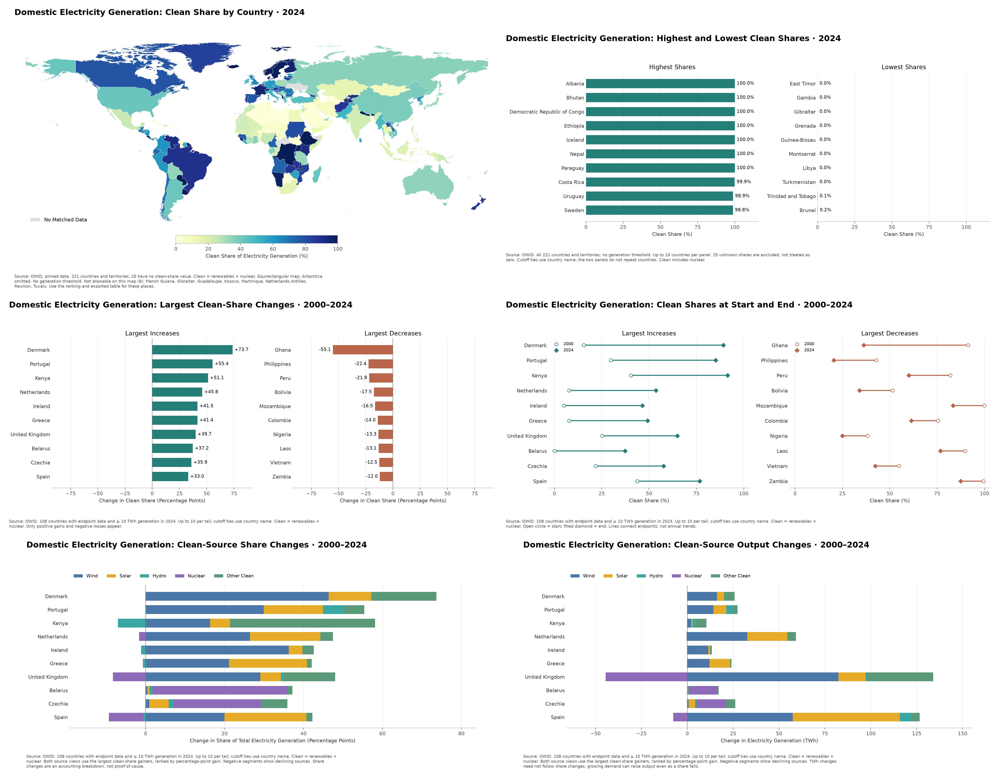

# Aurum: Cleaner Share, More Fossil Power? (Working Title)

CS-GY 6313 Information Visualization (NYU, Fall 2026), group project.
Team Aurum: Yathin Reddy Duvuru (yd3288), Yusuke Katsuki (yk3183).

Many countries raised the share of clean electricity between 2000 and 2024.
We ask whether they also generated less electricity from fossil fuels.
Of the 79 countries (out of 108 compared) that raised their clean share, 44 still generated more fossil electricity.

## Questions

1. How has the global electricity mix changed from 2000 to 2024, both in percentage shares and absolute generation (TWh)?
2. How do countries compare in their clean electricity shares in 2024? Which countries have the highest and lowest shares?
3. Which countries experienced the largest increases or decreases in clean electricity share between 2000 and 2024?
4. In countries with the largest increases in clean electricity share, how much did wind, solar, hydro, nuclear, and other clean sources each contribute?
5. Which countries increased their clean electricity share while also reducing fossil-fuel electricity generation, and which increased their clean share but still generated more fossil-fuel electricity?
6. How do electricity demand growth and the initial electricity mix in 2000 differ between countries that reduced fossil-fuel generation and those that did not?

## Layout

```
prep/buildTables.py      source-data processing and checks
sketches/          configurable Matplotlib EDA views (not the final D3 app)
tests/             data-selection, configuration, map, and report tests
reports/           sample tables and feature dictionary
data/raw/          pinned copies of the source files (do not edit)
data/processed/    the tables, made by prep/buildTables.py (do not edit by hand)
outputs/sketchesQ2-4.png  combined six-figure preview (tracked)
outputs/sketches/  generated figures, CSVs, and run settings (ignored)
```

## Tables

Two tables cover all six questions. Each chart picks its rows with a filter.

| Table | One row per | Used for |
|---|---|---|
| `country_year.csv` | country (and World) × year, 2000–2024 | Q1: `country == "World"` · Q2: `year == 2024 && country != "World"`, then sort by `clean_share_pct` (highest first, blanks last) · Q5 detail view: the selected country |
| `comparison_2000_2024.csv` | country, the 108 compared | Q3–Q6: the 2000 and 2024 values, the changes, demand growth, and the 2000 mix |
| `robustness.csv` | setting | the main result for other start years and TWh thresholds |

## Rebuild the Data

Install [uv](https://docs.astral.sh/uv/getting-started/installation/). Python 3.11 or later is supported;
`.python-version` selects Python 3.12 for local runs.

```sh
uv sync --locked
uv run python prep/buildTables.py
```

`pyproject.toml` declares dependencies; `uv.lock` records the resolved versions.
Use `uv add <package>` to add a dependency. There is no separate pip requirements file.

The script rebuilds the current baseline tables in `data/processed/` and checks the numbers. It stops with an error if the main result changes.
The old `comparison_2010_2024.csv` stays unchanged for reference. The current baseline uses `comparison_2000_2024.csv`.
The rules (which rows count as countries, which years, how missing values are handled) are commented at the top of `prep/buildTables.py`.

## Initial EDA Sketches

These are static exploratory views, not the final visualization design. The interactive app
will be built later in D3/JavaScript. All six chart titles state **Domestic Electricity
Generation**. The charts do not measure all energy use or classify imported electricity
by source.

```sh
uv run python -m sketches --preview outputs/sketchesQ2-4.png
```



The combined PNG above is tracked in version control. Other files under `outputs/`
remain ignored. The `--preview` option requires PNG output and assembles the six views
at their exported resolution. Omit it for experiments that should not replace the preview.

The default run writes six figures, each in PNG and SVG, to `outputs/sketches/`:

| Question | View A | View B |
|---|---|---|
| Q2: clean shares in 2024 | World map: geographic patterns | Highest/lowest ranked bars: exact comparisons |
| Q3: share change, 2000–2024 | Largest gains/losses in percentage points | The same countries' start/end shares: starting mix and final level |
| Q4: sources behind the largest share gains | Separate source-share changes in percentage points | The same countries' absolute generation changes in TWh |

Q4 uses diverging stacked bars so declining sources stay visible.
Source-share contributions add up to the clean-share change, but this
accounting breakdown does not prove a causal effect. Both Q4 views use countries selected
by **clean-share gain**, not by TWh gain. Wind, Solar, Hydro, and Nuclear appear
separately. Other Clean combines bioenergy and other renewables excluding bioenergy.

### Code and Checks

- `sketches/settings.py`: config loading and validation.
- `sketches/data.py`: reusable selection, rankings, and source-change calculations.
- `sketches/geography.py`: decode the pinned world-atlas geometry; no GIS install needed.
- `sketches/plots.py`: rendering only.
- `sketches/__main__.py`: CLI, exports, and manifest.
- `sketches/preview.py`: combined six-figure PNG.

```sh
uv run python -m unittest discover -s tests -v
```

## Sample Tables and Feature Dictionary

[CSV sample tables](reports/tables/) cover Q2, Q3, and Q4 only, including source
breakdowns in both pp and TWh. The [feature dictionary](reports/tables/feature_dictionary.csv)
documents the processed fields used for these questions. These tables use the preparation
baseline, not custom sketch settings. See [Data Handling and Initial Sketches](reports/dataHandlingSketches.md)
for the selection rules, sample data, and transformations.

## Data Notes for Sketching

- **Which countries:** Q1 uses the World row. Q2 uses every country (221). Q3–Q6 compare 108 countries:
  those with data in both 2000 and 2024 and at least 10 TWh of generation in 2024.
- **Blank means unknown, not 0.** Q2 has 25 countries with no 2024 clean share (Ukraine is one). Show them as "no data".
- **The map can't draw 8 of Q2's places** (`on_map` = false in `country_year.csv`), including Gibraltar,
  which has one of the lowest shares (0%). Pair the Q2 map with a ranked list.
- **"Clean" includes nuclear**, and shares are shares of generation, not of demand.

## Data

- **Energy:** Our World in Data, `owid_energy` (CC BY 4.0).
  <https://catalog.ourworldindata.org/energy/owid_energy/owid_energy.csv> · documentation: <https://github.com/owid/energy-data>.
  That URL always serves the latest version, so we use a copy pinned to the 30 Sep 2026 version: `data/raw/owid_energy_2026-09-30.csv`.
- **World map:** world-atlas 2.0.2, `countries-50m.json` (ISC license, made from Natural Earth).
  <https://cdn.jsdelivr.net/npm/world-atlas@2.0.2/countries-50m.json> · pinned copy in `data/raw/`.

## AI Use

Course policy allows generative AI if we disclose which parts it produced. We are responsible for any errors, and we can explain all submitted work.

| Date | Tool | What it produced | How we checked it |
|---|---|---|---|
| 2026-10-18 | Claude (Anthropic), Codex (OpenAI) | First draft and review of the M1 proposal text | Yusuke checked each section; Yathin expanded and submitted it |
| 2026-10-25 | Claude Code (Anthropic), Codex (OpenAI) | Repository setup and `prep/buildTables.py`; Codex reviewed them | Reviewed in a pull request before merging; the script re-checks the main numbers on every run |
| 2026-10-31 | Codex (OpenAI) | Python code and Matplotlib syntax for Q2–Q4, based on plot types and visualization descriptions specified by Yathin | Automated tests check data selection, source totals, and plot structure |
