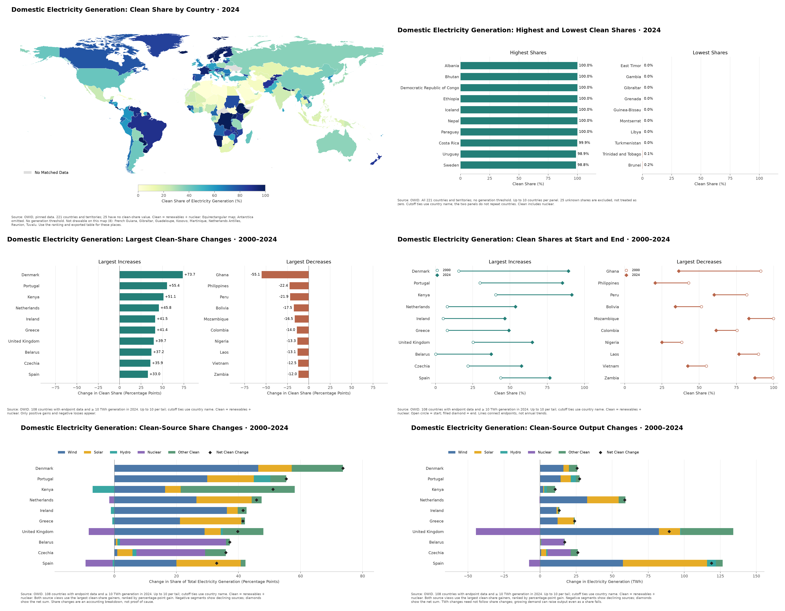
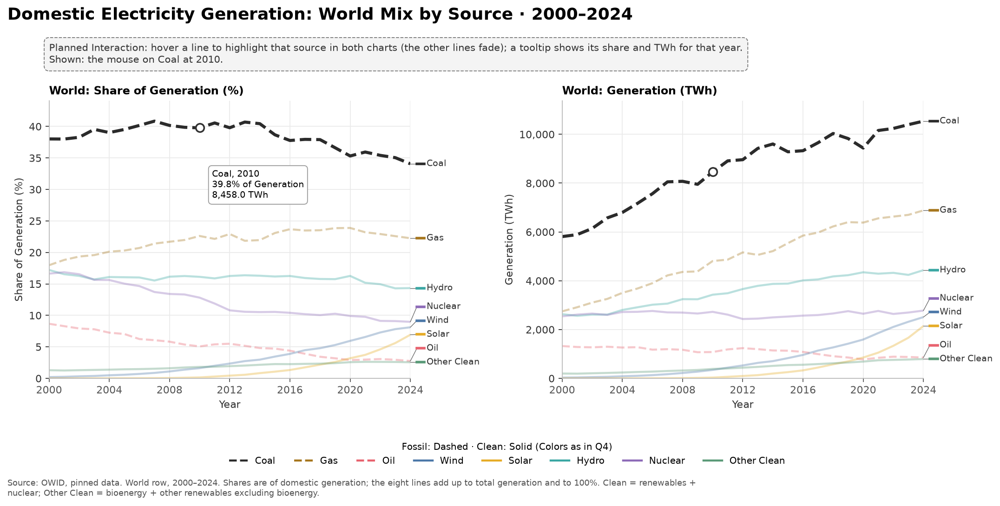
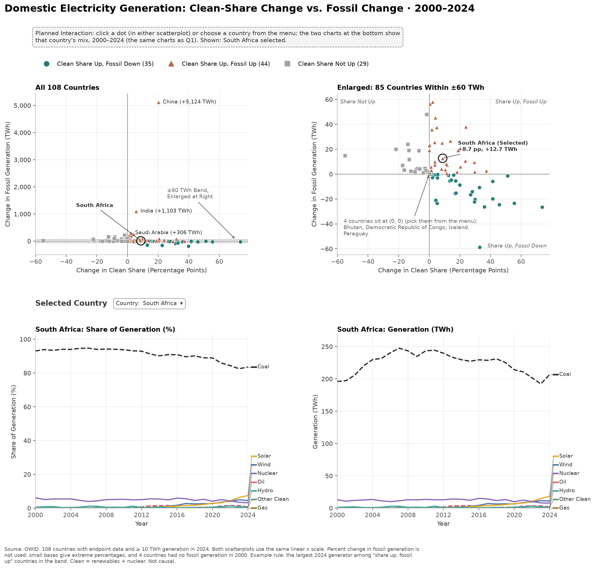
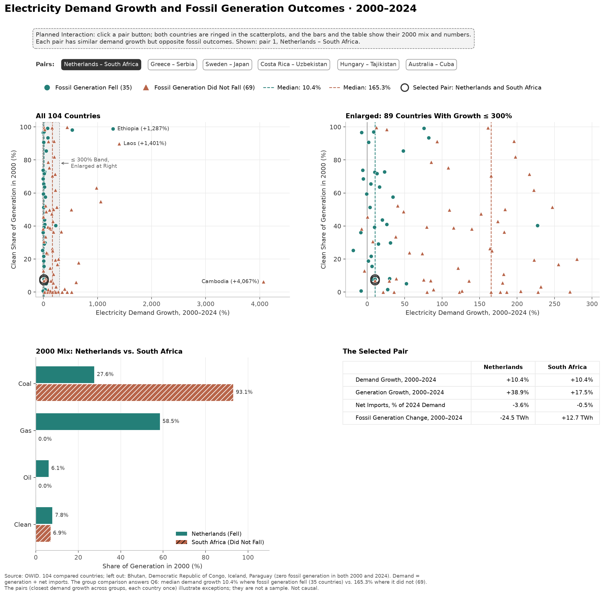

# Aurum: Cleaner Share, More Fossil Power? (working title)

CS-GY 6313 Information Visualization (NYU, Fall 2026), group project.
Team Aurum: Yathin Reddy Duvuru (yd3288), Yusuke Katsuki (yk3183).

Many countries raised the share of clean electricity between 2000 and 2024.
We ask whether they also generated less electricity from fossil fuels.
Of the 79 countries (out of 108 compared) that raised their clean share, 44 still generated more fossil electricity.

## Questions

1. How has the global electricity mix changed from 2000 to 2024, both in percentage shares and absolute generation (TWh)?
2. How do countries compare in their clean electricity shares in 2024? Which countries have the highest and lowest shares?
3. Which countries experienced the largest increases or decreases in clean electricity share between 2000 and 2024?
4. In countries with the largest increases in clean electricity share, how much did wind, solar, hydro, nuclear, and other clean sources each contribute?
5. Which countries increased their clean electricity share while also reducing fossil-fuel electricity generation, and which increased their clean share but still generated more fossil-fuel electricity?
6. How do electricity demand growth and the initial electricity mix in 2000 differ between countries that reduced fossil-fuel generation and those that did not?

## Layout

```
prep/build.py      source-data processing and checks
sketches/          configurable Matplotlib EDA views (not the final D3 app)
tests/             data-selection, configuration, map, and report tests
reports/           sample tables and feature dictionary
data/raw/          pinned copies of the source files (do not edit)
data/processed/    the tables, made by prep/build.py (do not edit by hand)
outputs/preview.png  combined six-figure preview, Q2–Q4 (tracked)
outputs/preview-q*.png  Q1, Q5, and Q6 previews (tracked)
outputs/sketches/  generated figures, CSVs, and run settings (ignored)
```

## Tables

Two tables cover all six questions. Each chart picks its rows with a filter.

| Table | One row per | Used for |
|---|---|---|
| `country_year.csv` | country (and World) × year, 2000–2024 | Q1: `country == "World"` · Q2: `year == 2024 && country != "World"`, then sort by `clean_share_pct` (highest first, blanks last) · Q5 detail view: the selected country |
| `comparison_2000_2024.csv` | country, the 108 compared | Q3–Q6: the 2000 and 2024 values, the changes, demand growth, and the 2000 mix |
| `robustness.csv` | setting | the main result for other start years and TWh thresholds |

## Rebuild the data

Install [uv](https://docs.astral.sh/uv/getting-started/installation/). Python 3.11 or later is supported;
`.python-version` selects Python 3.12 for local runs.

```sh
uv sync --locked
uv run python prep/build.py
```

`pyproject.toml` declares dependencies; `uv.lock` records the resolved versions.
Use `uv add <package>` to add a dependency. There is no separate pip requirements file.

The script rebuilds the current baseline tables in `data/processed/` and checks the numbers. It stops with an error if the main result changes.
The old `comparison_2010_2024.csv` stays unchanged for reference. The current baseline uses `comparison_2000_2024.csv`.
The rules (which rows count as countries, which years, how missing values are handled) are commented at the top of `prep/build.py`.

## Initial EDA sketches

These are static exploratory views, not the final visualization design. The interactive app
will be built later in D3/JavaScript. The Q1–Q5 chart titles state **Domestic Electricity
Generation**; the Q6 title names electricity demand, because its x-axis is demand growth.
The charts do not measure all energy use or classify imported electricity by source.

```sh
uv run python -m sketches --preview outputs/preview.png
```







The combined PNG above is tracked in version control. Other files under `outputs/`
remain ignored. The `--preview` option requires PNG output and assembles the six Q2–Q4 views
at their exported resolution; it copies the Q1, Q5, and Q6 figures next to it as
`preview-q1.png`, `preview-q5.png`, and `preview-q6.png`. Omit it for experiments that should
not replace the previews.

The default run writes nine figures, each in PNG and SVG, to `outputs/sketches/`:

| Question | View A | View B |
|---|---|---|
| Q2: clean shares in 2024 | World map: geographic patterns | Highest/lowest ranked bars: exact comparisons |
| Q3: share change, 2000–2024 | Largest gains/losses in percentage points | The same countries' start/end shares: starting mix and final level |
| Q4: sources behind the largest share gains | Separate source-share changes in percentage points | The same countries' absolute generation changes in TWh |
| Q1: the world mix, 2000–2024 | Eight source lines in shares (%) | The same lines in TWh |
| Q5: clean share vs. fossil generation | Scatterplots: all countries and an enlarged ±60 TWh band | The selected country's mix over the period (the Q1 charts) |
| Q6: demand growth and the 2000 mix | Scatterplots: all countries and an enlarged band up to 300% growth | One matched pair's 2000 mix and numbers |

The Q1, Q5, and Q6 figures (Yusuke) also sketch the planned interaction: a dashed box
describes it, and the image shows one state (a hover, a selected country, a selected pair).
Q5 and Q6 show an overview and an enlarged band on the same linear scale, because a few
very large values (China's fossil growth, Cambodia's demand growth) squeeze most countries
into a corner. Q5 keeps four outcomes, including "fossil unchanged", which appears in
other windows. Q6 answers the question with the two groups' medians; the pairs (closest
demand growth, opposite fossil outcomes) show exceptions, not a sample.

Q4 uses diverging stacked bars so declining sources stay visible. Diamonds mark the net
clean change. Source-share contributions add up to the clean-share change, but this
accounting breakdown does not prove a causal effect. Both Q4 views use countries selected
by **clean-share gain**, not by TWh gain. Wind, Solar, Hydro, and Nuclear appear
separately. Other Clean combines bioenergy and other renewables excluding bioenergy.

### Change dates, selections, and categories

Edit **`sketches/config.toml`**. It holds the snapshot year, comparison endpoints, number of
countries per tail, minimum endpoint generation, source groups/colors, output directory,
file formats, and resolution. `[q5]` and `[q6]` set the enlarged bands, the Q5 example
(by default chosen by a rule: the largest end-year generator among "share up, fossil up"
countries in the band), and the number of Q6 pairs. CLI flags override individual settings:

```sh
uv run python -m sketches --snapshot-year 2020 --start-year 2005 --end-year 2020 --top-n 5
uv run python -m sketches --min-generation-twh 5 --output-dir outputs/threshold-5
uv run python -m sketches --config path/to/experiment.toml
uv run python -m sketches --format png
```

Output paths in the config and CLI are relative to the repository root unless absolute.
Date changes recalculate everything from `country_year.csv`; they do not relabel the
fixed 2000–2024 comparison table. Years must exist in the processed data, currently
2000–2024. Expanding that range needs a separate update to `prep/build.py` and its checks.

To change categories, edit the `[[groups]]` entries. For example, split Other Clean
into Bioenergy and Other Renewables Excluding Bioenergy. Each of the six clean sources must appear exactly once, so no source
can be double-counted or silently dropped. The sketch code does not change the definition
of clean electricity.

Selection rules:
- Q2 includes all countries and territories, with no generation threshold. Unknown shares
  remain missing. The map uses longitude/latitude (equirectangular), not equal-area geometry;
  Antarctica is omitted. Places absent from the map stay in the rankings and CSV.
- Q3–Q4 require clean-share and fossil-generation data at both endpoints and at least the
  configured generation threshold in the **end year**, matching the preparation pipeline.
- Rankings show at most `top_n` countries per tail. Cutoff ties use country name. The high
  and low snapshot tails do not overlap. Change tails show only positive gains/negative losses.
- Q4 uses up to `top_n` positive clean-share gainers, in the same order for both measures.
  Missing source data causes an error instead of being plotted as zero.
- Q5 uses the same countries as Q3–Q4. Fossil change stays in TWh; percentage change is not
  used because some countries start from zero or near zero.
- Q6 leaves out countries with zero fossil generation at both endpoints (nothing to cut).
  Pairs are chosen greedily by the smallest demand-growth gap, each country once, ties by name.

Each run also exports the full snapshot, comparison data, both Q4 breakdown tables, the
Q1 world mix, the Q5 outcomes, the Q6 pairs, and a
JSON manifest with the settings and selected countries. Filenames include the dates.
Rerunning the same dates replaces those files; use a separate output directory to preserve
threshold/category experiments. Only `outputs/preview.png` and `outputs/preview-q*.png` are
versioned; individual figures, exported CSVs, and manifests remain ignored.

### Code and checks

- `sketches/settings.py`: config loading and validation.
- `sketches/data.py`: reusable selection, rankings, and source-change calculations.
- `sketches/geography.py`: decode the pinned world-atlas geometry; no GIS install needed.
- `sketches/plots.py`: rendering only.
- `sketches/__main__.py`: CLI, exports, and manifest.
- `sketches/preview.py`: combined six-figure PNG.
- `sketches/q156_data.py`, `sketches/q156_plots.py`: Q1, Q5, and Q6 calculations and rendering.
- `prep/report_q156.py`: the Q1, Q5, Q6, and cutoff sections of the report.

```sh
uv run python -m unittest discover -s tests -v
```

## Sample Tables and Feature Dictionary

[CSV sample tables](reports/tables/) cover Q1–Q6, including source
breakdowns in both pp and TWh. The [feature dictionary](reports/tables/feature_dictionary.csv)
documents the processed fields used for these questions. These tables use the preparation
baseline, not custom sketch settings. Rebuild them after rebuilding the processed tables:

```sh
uv run python -m prep.report
```

## Data notes for sketching

- **Which countries:** Q1 uses the World row. Q2 uses every country (221). Q3–Q6 compare 108 countries:
  those with data in both 2000 and 2024 and at least 10 TWh of generation in 2024.
- **Blank means unknown, not 0.** Q2 has 25 countries with no 2024 clean share (Ukraine is one). Show them as "no data".
- **The map can't draw 8 of Q2's places** (`on_map` = false in `country_year.csv`), including Gibraltar,
  which has one of the lowest shares (0%). Pair the Q2 map with a ranked list.
- **"Clean" includes nuclear**, and shares are shares of generation, not of demand.

## Data

- **Energy:** Our World in Data, `owid_energy` (CC BY 4.0).
  <https://catalog.ourworldindata.org/energy/owid_energy/owid_energy.csv> · documentation: <https://github.com/owid/energy-data>.
  That URL always serves the latest version, so we use a copy pinned to the 30 Sep 2026 version: `data/raw/owid_energy_2026-09-30.csv`.
- **World map:** world-atlas 2.0.2, `countries-50m.json` (ISC license, made from Natural Earth).
  <https://cdn.jsdelivr.net/npm/world-atlas@2.0.2/countries-50m.json> · pinned copy in `data/raw/`.

## AI use

Course policy allows generative AI if we disclose which parts it produced. We are responsible for any errors, and we can explain all submitted work.

| Date | Tool | What it produced | How we checked it |
|---|---|---|---|
| 2026-10-18 | Claude (Anthropic), Codex (OpenAI) | First draft and review of the M1 proposal text | Yusuke checked each section; Yathin expanded and submitted it |
| 2026-10-25 | Claude Code (Anthropic), Codex (OpenAI) | Repository setup and `prep/build.py`; Codex reviewed them | Reviewed in a pull request before merging; the script re-checks the main numbers on every run |
| 2026-10-27 to 10-30 | Claude Code (Anthropic), Codex (OpenAI) | Code for Yusuke's Q1, Q5, and Q6 sketches, their report sections, and tests; Codex reviewed the plan and the code | Yusuke chose the designs and reviewed the figures; tests check the sums, counts, and that the report matches the sketches |
