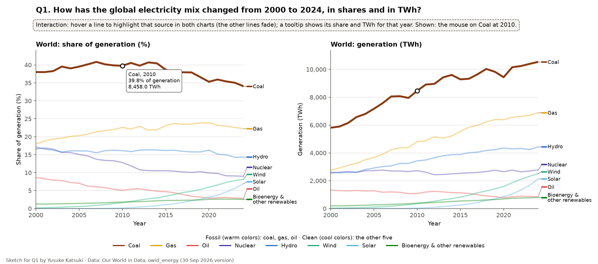
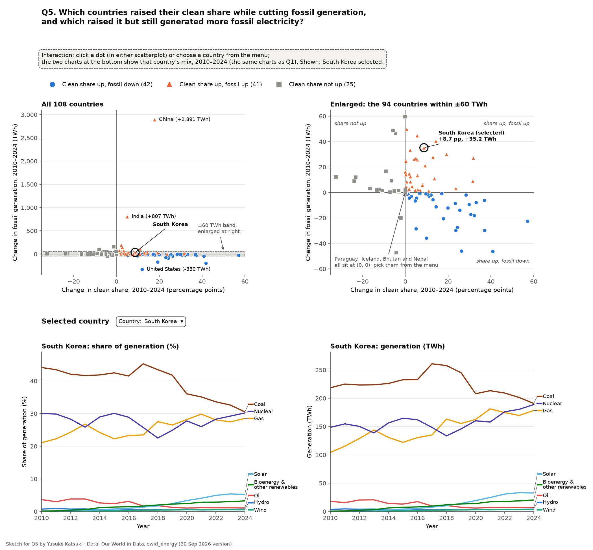
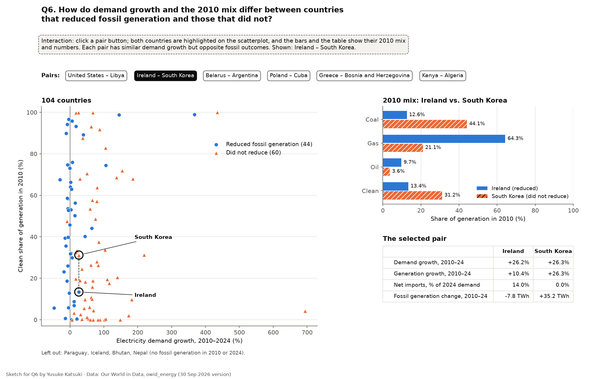

# Milestone 2: Data Analysis and Sketches (working draft)

Team Aurum: Yathin Reddy Duvuru (yd3288), Yusuke Katsuki (yk3183).
Repository: <https://github.com/Yahtze/InfoViz-Aurum>. Due **Mon Nov 2**.

For each question: the transformation, a sample of the processed data, and a sketch.
Items marked **[decide]** are proposals. The owner of each question decides the ones for their question.
Every sample below is copied from `data/processed/` (made by `prep/build.py`), not typed by hand.

## Audience [decide]

Default: **energy policy staff in countries where electricity demand is growing fast.**
They need to know whether adding clean power is enough to cut fossil generation, or whether demand growth eats the gain.
(Other candidate: general readers of climate news.)

## Terms (M1 feedback 2)

- **TWh (terawatt-hour):** a unit of electricity. 1 TWh is a billion kilowatt-hours.
- **Generation:** electricity produced inside the country, in TWh.
- **Demand:** electricity used in the country. Demand = generation + net imports.
  The two differ for countries that trade a lot of electricity. In 2024, 29 of our 108 countries had net imports or net exports above 10% of demand (15 net importers, 14 net exporters).
- **Clean electricity:** nuclear, hydro, solar, wind, bioenergy, and other renewables (OWID's "low-carbon"). It **includes nuclear**.
- **Fossil-fuel generation:** electricity from coal, gas, and oil, in TWh.
- **Share:** a source's generation divided by total generation, in %.
- **Percentage points (pp):** the difference between two shares. A share going from 30% to 40% is +10 pp.

Q1–Q5 use **generation**. Q6 uses **demand growth** for the hypothesis and shows generation growth and net imports next to it, so importers are visible.

## Cutoffs (M1 feedback 3)

Q3–Q6 compare countries with data in both 2010 and 2024 and at least 10 TWh of generation in 2024 (108 countries).
We varied both cutoffs. Among the countries that raised their clean share, the share that still generated more fossil electricity:

| Start year | ≥ 0 TWh | ≥ 5 TWh | ≥ 10 TWh | ≥ 20 TWh | ≥ 50 TWh |
|---|---|---|---|---|---|
| 2000 | 59.9% (82/137) | 56.4% (53/94) | 55.7% (44/79) | 56.9% (37/65) | 53.7% (22/41) |
| 2005 | 52.5% (73/139) | 48.9% (46/94) | 49.4% (39/79) | 50.0% (31/62) | 50.0% (20/40) |
| **2010** | 51.4% (74/144) | 47.5% (47/99) | **49.4% (41/83)** | 47.1% (32/68) | 52.2% (24/46) |
| 2015 | 46.7% (71/152) | 45.7% (48/105) | 46.7% (42/90) | 45.8% (33/72) | 47.9% (23/48) |

In every setting, 46–60% of these countries still generated more fossil electricity. The exact number moves; it is highest when the comparison starts in 2000.
This checks the headline count only, not the demand-growth hypothesis (Q6).

- **10 TWh:** we focus on larger electricity systems. In a very small system, one project can move the share a lot. The threshold keeps 108 of 195 countries.
- **2010:** in 2010, wind and solar were still small: 1.8% of world generation. By 2024 they were 15.0%, so about 90% of their gain since 2000 came in 2010–2024. Q4 asks how much of the change came from wind and solar, so we compare over this period. 2010 is not a turning point: the world's clean share stayed near 32% from 2007 to 2013, and the table above shows the result does not depend on the exact year.
- **Why Q1 starts in 2000:** 2000 is the first year with electricity data for almost every country (212, vs. 81 in 1999). Q1 shows this longer background: the world's clean share fell from 35.3% (2000) to 32.5% (2010), then rose to 40.9% (2024).

## Q4 metric (M1 feedback 1) [decide]

Default: each source group's **contribution to the change in clean share**, in percentage points.

`contribution(group) = share(group, 2024) − share(group, 2010)`

The groups are wind + solar, hydro + nuclear, and other clean (bioenergy and other renewables).
The three contributions add up exactly to the Q3 measure, so Q3 and Q4 tell one story.
(The other reading, the change in each source's TWh, answers "how much more power?". It can disagree: hydro can grow in TWh while its share falls.)

## Questions

Owners (agreed in chat on Oct 27): **Yusuke: Q1, Q5, Q6 · Yathin: Q2, Q3, Q4.**
Two tables cover all six questions; each question picks its rows with a filter.

### Q1. How has the global electricity mix changed from 2000 to 2024, in shares and in TWh?

- **Data:** `country_year.csv`, rows where `country == "World"`. Unit: year (25 rows).
- **Measures:** TWh by source (nine sources), and shares. A source's share = its TWh ÷ `generation_twh` × 100; the table has a `*_share_pct` column for each source.
- **Comparison:** share vs. TWh over time.
- **Interaction:** hover a line to highlight that source in both charts; a tooltip shows its share and TWh for that year.
- **Sketch** (Yusuke, `sketches/q1.py`): two line charts side by side, share (%) and TWh, with year on x and one line per source.
  Bioenergy and other renewables share one line (other renewables alone are about 0.3% of world generation), so there are eight lines.
  Fossil sources are warm colors and clean sources cool colors; each line is named at its end.

  

Sample (every second year):

| `year` | `generation_twh` | `coal_twh` | `gas_twh` | `oil_twh` | `nuclear_twh` | `hydro_twh` | `wind_twh` | `solar_twh` | `bioenergy_twh` | `other_renewables_excluding_bioenergy_twh` | `clean_share_pct` | `fossil_share_pct` |
|---|---|---|---|---|---|---|---|---|---|---|---|---|
| 2000 | 15278.8 | 5808.8 | 2745.6 | 1324.3 | 2540.5 | 2629.7 | 31.1 | 1.0 | 154.1 | 43.6 | 35.3 | 64.7 |
| 2002 | 16049.9 | 6144.3 | 3104.8 | 1271.8 | 2654.8 | 2611.6 | 52.2 | 1.7 | 162.8 | 45.8 | 34.4 | 65.6 |
| 2004 | 17415.0 | 6797.3 | 3503.1 | 1263.7 | 2719.4 | 2802.6 | 85.5 | 2.8 | 192.4 | 48.3 | 33.6 | 66.4 |
| 2006 | 18839.0 | 7567.0 | 3900.6 | 1175.8 | 2761.6 | 3018.1 | 133.2 | 5.4 | 226.6 | 50.8 | 32.9 | 67.1 |
| 2008 | 20102.6 | 8074.2 | 4361.0 | 1171.7 | 2694.7 | 3245.3 | 220.8 | 11.8 | 266.4 | 56.6 | 32.3 | 67.7 |
| 2010 | 21263.8 | 8458.0 | 4807.9 | 1078.7 | 2725.9 | 3428.2 | 346.0 | 32.2 | 327.2 | 59.7 | 32.5 | 67.5 |
| 2012 | 22515.7 | 8960.3 | 5161.4 | 1238.6 | 2432.2 | 3660.2 | 529.3 | 96.9 | 374.0 | 62.8 | 31.8 | 68.2 |
| 2014 | 23747.1 | 9603.8 | 5214.1 | 1143.7 | 2498.7 | 3870.7 | 706.1 | 197.7 | 442.7 | 69.5 | 32.8 | 67.2 |
| 2016 | 24694.5 | 9328.0 | 5849.9 | 1085.1 | 2571.1 | 4014.8 | 960.3 | 327.5 | 482.1 | 75.9 | 34.1 | 65.9 |
| 2018 | 26464.5 | 10033.0 | 6224.6 | 908.6 | 2658.7 | 4176.8 | 1268.1 | 575.2 | 537.7 | 81.7 | 35.1 | 64.9 |
| 2020 | 26723.4 | 9437.0 | 6382.9 | 775.9 | 2648.3 | 4347.0 | 1591.5 | 853.4 | 601.2 | 86.1 | 37.9 | 62.1 |
| 2022 | 28917.8 | 10240.4 | 6628.3 | 887.4 | 2639.6 | 4324.1 | 2107.7 | 1333.1 | 669.2 | 87.9 | 38.6 | 61.4 |
| 2024 | 30930.2 | 10538.9 | 6882.7 | 853.8 | 2777.1 | 4433.6 | 2509.5 | 2142.7 | 703.4 | 88.4 | 40.9 | 59.1 |

### Q2. How do countries compare in their clean electricity share in 2024?

- **Data:** `country_year.csv`, rows where `year == 2024 && country != "World"`, sorted by `clean_share_pct` (highest first, blanks last). Unit: country (221).
- **Measure:** clean share in 2024. **Comparison:** across countries, on a map with a ranked list.
- **Missing data:** 25 places have a blank clean share, shown as "no data". For 24 of them the data is missing (Ukraine is one).
  Lesotho is different: OWID records 0 TWh of generation, so a share can't be computed.
  The map can't draw 8 places (`on_map` = false), so the ranked list shows every country.
- **Interaction [decide]:** hover a country on the map or the list to see its share and generation.
- **Sketch:** _to add_

Sample (top 3, the middle 4, bottom 3, and 3 blanks):

| `country` | `iso3` | `iso_numeric` | `clean_share_pct` | `generation_twh` | `on_map` |
|---|---|---|---|---|---|
| Democratic Republic of Congo | COD | 180 | 100.0 | 15.9 | True |
| Albania | ALB | 008 | 100.0 | 8.3 | True |
| Ethiopia | ETH | 231 | 100.0 | 25.2 | True |
| Cambodia | KHM | 116 | 35.7 | 15.5 | True |
| Gabon | GAB | 266 | 35.4 | 2.6 | True |
| Australia | AUS | 036 | 35.1 | 281.6 | True |
| Djibouti | DJI | 262 | 35.0 | 0.2 | True |
| Grenada | GRD | 308 | 0.0 | 0.2 | True |
| Gibraltar | GIB | 292 | 0.0 | 0.2 | False |
| East Timor | TLS | 626 | 0.0 | 0.5 | True |
| Lesotho | LSO | 426 | (blank) | 0.0 | True |
| Martinique | MTQ | 474 | (blank) | (blank) | False |
| Ukraine | UKR | 804 | (blank) | (blank) | True |

### Q3. Which countries had the largest increases or decreases in clean share, 2010–2024?

- **Data:** `comparison_2010_2024.csv`. Unit: country (108).
- **Measure:** `d_clean_share_pp` = clean share 2024 − clean share 2010, in pp. **Comparison:** largest rises vs. largest falls.
- **Interaction [decide]:** hover a bar to see the 2010 and 2024 shares.
- **Sketch:** _to add_

Sample (6 largest rises, 6 largest falls):

| `country` | `clean_share_pct_2010` | `clean_share_pct_2024` | `d_clean_share_pp` |
|---|---|---|---|
| Denmark | 32.1 | 89.2 | 57.1 |
| United Kingdom | 23.1 | 64.9 | 41.8 |
| Netherlands | 12.8 | 53.7 | 40.8 |
| Finland | 58.3 | 95.3 | 37.1 |
| Belarus | 0.4 | 37.3 | 36.9 |
| Ireland | 13.4 | 46.5 | 33.1 |
| Zambia | 99.9 | 87.5 | -12.4 |
| Georgia | 93.2 | 79.8 | -13.3 |
| Mozambique | 99.9 | 83.4 | -16.5 |
| Laos | 100.0 | 76.7 | -23.3 |
| Myanmar | 71.8 | 47.9 | -24.0 |
| Ghana | 68.7 | 36.2 | -32.5 |

### Q4. In the countries with the largest increases, how much came from wind and solar vs. hydro and nuclear?

- **Data:** `comparison_2010_2024.csv`, the countries with the largest `d_clean_share_pp`. Unit: country.
- **Measure:** contribution of each source group, in pp (see "Q4 metric"). The three columns add up to `d_clean_share_pp`.
  A contribution can be negative (Greece: hydro + nuclear −6.9 pp).
- **Comparison:** wind + solar vs. hydro + nuclear, within each country.
- **Interaction [decide]:** hover a segment to see the group's contribution.
- **Sketch:** _to add_

Sample (10 largest increases):

| `country` | `d_wind_solar_share_pp` | `d_hydro_nuclear_share_pp` | `d_other_clean_share_pp` | `d_clean_share_pp` |
|---|---|---|---|---|
| Denmark | 48.8 | 0.0 | 8.3 | 57.1 |
| United Kingdom | 31.8 | -0.9 | 10.9 | 41.8 |
| Netherlands | 41.8 | -0.5 | -0.5 | 40.8 |
| Finland | 25.6 | 12.5 | -1.0 | 37.1 |
| Belarus | 1.0 | 35.0 | 0.9 | 36.9 |
| Ireland | 30.7 | 0.3 | 2.1 | 33.1 |
| Portugal | 27.8 | 1.3 | 3.1 | 32.2 |
| United Arab Emirates | 8.7 | 22.9 | 0.1 | 31.7 |
| Cambodia | 6.9 | 25.1 | -0.5 | 31.5 |
| Greece | 36.6 | -6.9 | 0.9 | 30.6 |

### Q5. Which countries raised their clean share while cutting fossil generation, and which raised it but still generated more fossil electricity?

- **Data:** `comparison_2010_2024.csv` for the scatterplot; `country_year.csv` for the selected country's mix over time. Unit: country (108).
- **Measures:** Δ clean share (pp) on x, `d_fossil_twh` = fossil TWh 2024 − fossil TWh 2010 on y. `outcome` sorts each country into one of three groups.
- **Comparison:** share up with fossil down vs. share up with fossil up.
- **Crowding:** China (+2,891 TWh) is far above every other country, so we draw the scatterplot twice, both linear and with the same x scale:
  all 108 countries, and the 94 countries within ±60 TWh enlarged.
  (A % change axis is worse: Zambia is +24,600% from a tiny base, and the 5 countries with no fossil generation in 2010 have no % change.)
- **Interaction:** click a dot, or choose a country from a menu, to see its electricity mix in 2010–2024 in the same two charts as Q1 (as the feedback suggests).
  The menu also reaches Paraguay, Iceland, Bhutan and Nepal, which all sit at (0, 0).
- **Sketch** (Yusuke, `sketches/q5.py`): x = Δ clean share (pp), y = Δ fossil TWh, color and shape = `outcome`.
  It shows South Korea selected (+8.7 pp, +35.2 TWh).

  

Sample (the 12 largest by 2024 generation):

| `country` | `d_clean_share_pp` | `fossil_twh_2010` | `fossil_twh_2024` | `d_fossil_twh` | `outcome` |
|---|---|---|---|---|---|
| China | 17.7 | 3346.0 | 6237.2 | 2891.2 | share_up_fossil_up |
| United States | 11.9 | 2882.5 | 2552.5 | -330.0 | share_up_fossil_down |
| India | 4.9 | 771.8 | 1578.4 | 806.6 | share_up_fossil_up |
| Russia | 3.4 | 700.6 | 774.7 | 74.2 | share_up_fossil_up |
| Japan | -4.2 | 745.4 | 698.4 | -47.1 | share_not_up |
| Brazil | 1.8 | 63.9 | 78.7 | 14.8 | share_up_fossil_up |
| Canada | 1.8 | 146.3 | 142.0 | -4.3 | share_up_fossil_down |
| South Korea | 8.7 | 340.7 | 375.9 | 35.2 | share_up_fossil_up |
| France | 5.1 | 57.2 | 28.7 | -28.5 | share_up_fossil_down |
| Germany | 19.2 | 378.2 | 205.1 | -173.1 | share_up_fossil_down |
| Saudi Arabia | 2.2 | 248.8 | 444.8 | 196.1 | share_up_fossil_up |
| Iran | 2.8 | 225.2 | 367.4 | 142.1 | share_up_fossil_up |

### Q6. How do demand growth and the 2010 mix differ between countries that reduced fossil generation and those that did not?

- **Data:** `comparison_2010_2024.csv`, without the 4 countries that had no fossil generation in 2010 or 2024. Unit: country (104).
- **Groups:** `fossil_reduced` (fossil TWh fell from 2010 to 2024): 44 reduced, 60 did not.
  We leave out Paraguay, Iceland, Bhutan and Nepal: with no fossil generation in either year, they had nothing to cut.
  Laos stays (0 TWh in 2010, 12.2 TWh in 2024).
- **Measures:** `demand_growth_pct` = (demand 2024 − demand 2010) ÷ demand 2010 × 100, with generation growth and net imports next to it; the 2010 mix (coal, gas, oil, and clean shares).
- **Comparison:** countries with similar demand growth but different fossil outcomes (as the feedback suggests). We describe the exceptions and do not treat the comparison as causal.
  The hypothesis would be weakened if, across all 104 countries, the two groups had similar demand growth; one exceptional pair would not refute it.
- **Interaction:** six buttons, one for each pair in the sample below (Ireland – South Korea first).
  The chosen pair is highlighted on the scatterplot; bars show their 2010 mix, next to their demand growth, generation growth, net imports and change in fossil generation.
- **Sketch** (Yusuke, `sketches/q6.py`): a scatterplot with demand growth (%) on x, the 2010 clean share (%) on y, and color and shape = group.

  

Sample (the 6 pairs with the closest demand growth, one country from each group; each country used once):

| `pair` | `country` | `fossil_reduced` | `demand_growth_pct` | `generation_growth_pct` | `d_fossil_twh` | `net_imports_share_of_demand_pct_2024` | `coal_share_pct_2010` | `gas_share_pct_2010` | `oil_share_pct_2010` | `clean_share_pct_2010` |
|---|---|---|---|---|---|---|---|---|---|---|
| 1 | United States | True | 6.4 | 6.7 | -330.0 | 0.3 | 44.9 | 24.0 | 1.2 | 29.9 |
| 1 | Libya | False | 6.5 | 6.2 | 2.0 | 0.0 | 0.0 | 47.1 | 52.9 | 0.0 |
| 2 | Ireland | True | 26.2 | 10.4 | -7.8 | 14.0 | 12.6 | 64.3 | 9.7 | 13.4 |
| 2 | South Korea | False | 26.3 | 26.3 | 35.2 | 0.0 | 44.1 | 21.1 | 3.6 | 31.2 |
| 3 | Belarus | True | 20.3 | 31.3 | -6.0 | -1.3 | 0.1 | 97.1 | 2.4 | 0.4 |
| 3 | Argentina | False | 20.1 | 21.0 | 5.6 | 5.7 | 2.4 | 50.6 | 13.7 | 33.3 |
| 4 | Poland | True | 12.0 | 9.8 | -27.4 | 1.1 | 87.1 | 3.1 | 2.9 | 6.9 |
| 4 | Cuba | False | 11.7 | 11.7 | 1.8 | 0.0 | 0.0 | 13.0 | 83.7 | 3.3 |
| 5 | Greece | True | -8.9 | 0.8 | -17.1 | -0.5 | 54.4 | 17.4 | 9.6 | 18.6 |
| 5 | Bosnia and Herzegovina | False | -8.5 | -8.5 | 0.3 | 0.0 | 52.0 | 0.3 | 0.3 | 47.4 |
| 6 | Kenya | True | 106.0 | 85.2 | -0.7 | 10.1 | 0.0 | 0.0 | 25.6 | 74.4 |
| 6 | Algeria | False | 105.5 | 110.7 | 49.8 | -2.7 | 0.0 | 97.5 | 2.1 | 0.4 |

## Data access

- **Energy:** Our World in Data, `owid_energy` (CC BY 4.0), <https://catalog.ourworldindata.org/energy/owid_energy/owid_energy.csv>.
  That URL always serves the latest version; the repository keeps a copy pinned to the 30 Sep 2026 version.
- **World map:** world-atlas 2.0.2, `countries-50m.json` (ISC license, from Natural Earth), <https://cdn.jsdelivr.net/npm/world-atlas@2.0.2/countries-50m.json>.
- To rebuild every table: see "Rebuild the data" in the repository's `README.md`.

## AI use

| Tool | What it produced | How we checked it |
|---|---|---|
| Claude Code (Anthropic) | `prep/build.py`, the text of this document, the sample tables (printed from `data/processed/` by a script), design options for the Q1, Q5 and Q6 sketches, and their Matplotlib code (`sketches/`) | _to fill_ |
| Codex (OpenAI) | Reviews of `prep/build.py`, of this document and of the sketch code; design options for the Q1, Q5 and Q6 sketches | _to fill_ |

The final decisions are ours. For Q1, Q5 and Q6, Claude and Codex proposed design options, Yusuke chose among them, and Claude wrote the Matplotlib code for the chosen designs.

## Before submitting

- [ ] Decide the [decide] items, then remove the alternatives and the [decide] marks
- [ ] One sketch per question (shared views are fine if we say which questions they answer), each with its owner's name.
      Each sketch shows titles, axis labels with units, a legend, and the interaction
- [ ] Labels are readable, compared views share scales, missing data is shown, categories do not rely on color alone
- [ ] Fill in "How we checked it"; add the same rows to the AI table in `README.md`
- [ ] Repository shared with `ctsilva` and `kimryan0416`; link in the submission
- [ ] If we use an Observable notebook: make it public or unlisted, attach the CSVs to it (no loading from GitHub URLs), and add its URL to `README.md`
- [ ] Delete this checklist
