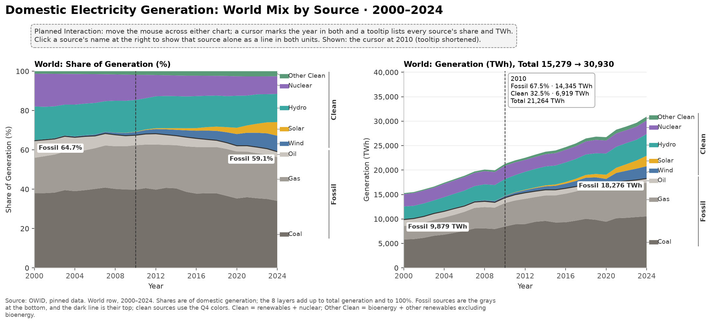
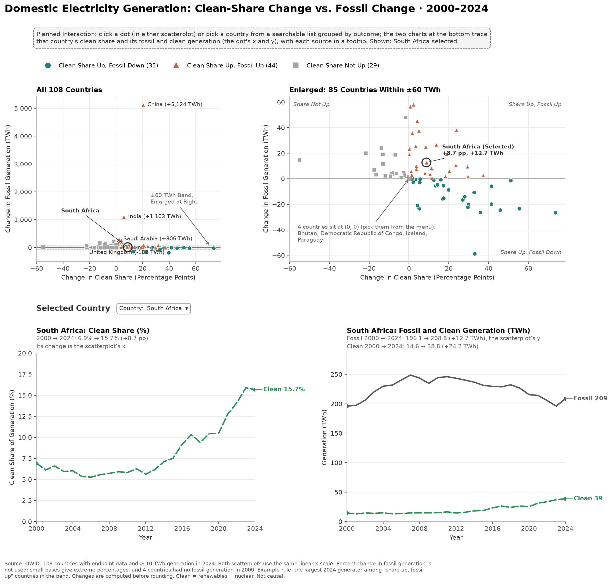
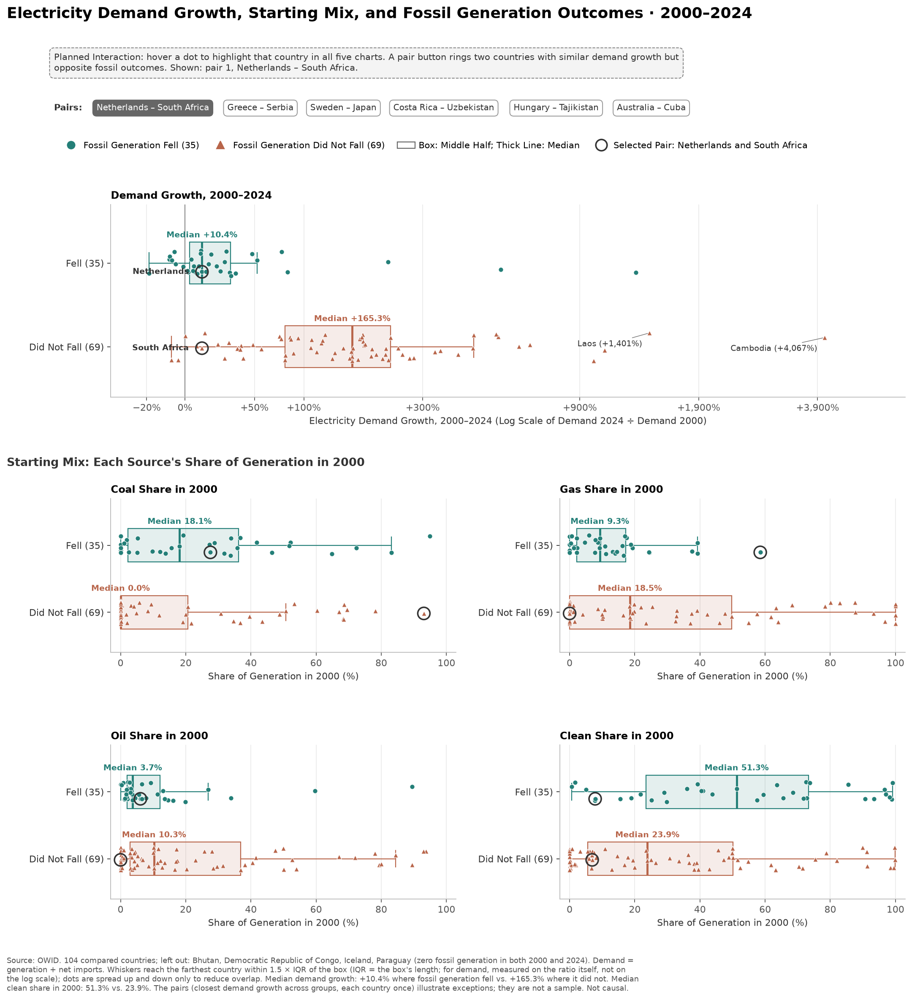

# Data Handling for Q1, Q5, and Q6

## Scope and Current State

This report covers **Q1, Q5, and Q6**, the questions Yusuke explored with three Matplotlib
sketches. [Data Handling and Initial Sketches](dataHandlingQ2Q3Q4.md) covers Q2–Q4. The
sketches are exploratory views, not the final D3 application.

Both reports use the same data, definitions, filters, and stored tables, described in
[Shared Data Handling](dataHandlingQ2Q3Q4.md#shared-data-handling). This report adds what
Q1, Q5, and Q6 need beyond that, and explains the start year and the size threshold.

The baseline is 2000–2024, with a minimum of 10 TWh generation in 2024 for the
country comparisons. Q1 reads the World row of country_year.csv. Q5 recalculates the
comparison from country_year.csv with fixed baseline settings; it uses the same 108 countries
as comparison_2000_2024.csv, and the tests check that the two agree. Q6 starts from these 108
and keeps 104: it leaves out the 4 with no fossil generation in either year.
Custom sketch settings never change this report.

The tables below contain real processed rows, not synthetic examples. They are
**case samples**, not random or population-weighted samples. Each section states
the selection rule. The report displays two decimal places; downloadable CSVs retain
four decimals where applicable. **No Data** means unknown, not zero. CSV samples use blank
cells for the same unknown values. Q5 and Q6 show associations, not causes.

## Additional Definitions and Filters

- Q1 uses only the World row. Q5 and Q6 exclude it, as Q2–Q4 do.
- The Q1 and Q5 chart titles state **Domestic Electricity Generation**, like Q2–Q4. The Q6
  title names electricity demand, because its x-axis is demand growth.
- TWh (terawatt-hours) measures amounts of electricity: 1 TWh = 1 billion kWh.
- Demand is domestic generation plus net imports (OWID electricity_demand_twh).
  Generation and demand differ when a country trades electricity: 29 of the
  108 compared countries had net trade above 10% of their 2024 demand
  (15 net importers, 14 net exporters).

## Q1 — The World's Electricity Mix

**Question:** How has the global electricity mix changed from 2000 to 2024, in shares and in TWh?

**Transformation:** select the World row for 2000–2024. Group the sources into Coal, Gas, Oil,
Wind, Solar, Hydro, Nuclear, and Other Clean. The sketch checks that each year's values add up
to total generation and to 100% within 0.01.

**Result:** the clean share rose from 35.3% to 40.9%, but total generation grew from 15,279 TWh to 30,930 TWh. So fossil generation also grew, from 9,879 TWh to 18,276 TWh.
Q5 asks the same question for each country.

**Sample:** every fourth year from 2000 through 2024. The first table gives shares, the second TWh.

| Year | Coal (%) | Gas (%) | Oil (%) | Wind (%) | Solar (%) | Hydro (%) | Nuclear (%) | Other Clean (%) | Total Generation (TWh) |
| --- | --- | --- | --- | --- | --- | --- | --- | --- | --- |
| 2000 | 38.02 | 17.97 | 8.67 | 0.20 | 0.01 | 17.21 | 16.63 | 1.29 | 15,278.78 |
| 2004 | 39.03 | 20.12 | 7.26 | 0.49 | 0.02 | 16.09 | 15.62 | 1.38 | 17,414.99 |
| 2008 | 40.16 | 21.69 | 5.83 | 1.10 | 0.06 | 16.14 | 13.40 | 1.61 | 20,102.64 |
| 2012 | 39.80 | 22.92 | 5.50 | 2.35 | 0.43 | 16.26 | 10.80 | 1.94 | 22,515.66 |
| 2016 | 37.77 | 23.69 | 4.39 | 3.89 | 1.33 | 16.26 | 10.41 | 2.26 | 24,694.51 |
| 2020 | 35.31 | 23.89 | 2.90 | 5.96 | 3.19 | 16.27 | 9.91 | 2.57 | 26,723.37 |
| 2024 | 34.07 | 22.25 | 2.76 | 8.11 | 6.93 | 14.33 | 8.98 | 2.56 | 30,930.23 |

[Download CSV](tablesQ1Q5Q6/q1_world_share_sample.csv)

| Year | Coal (TWh) | Gas (TWh) | Oil (TWh) | Wind (TWh) | Solar (TWh) | Hydro (TWh) | Nuclear (TWh) | Other Clean (TWh) | Total Generation (TWh) |
| --- | --- | --- | --- | --- | --- | --- | --- | --- | --- |
| 2000 | 5,808.81 | 2,745.57 | 1,324.32 | 31.15 | 1.02 | 2,629.67 | 2,540.46 | 197.78 | 15,278.78 |
| 2004 | 6,797.30 | 3,503.08 | 1,263.66 | 85.48 | 2.78 | 2,802.61 | 2,719.41 | 240.67 | 17,414.99 |
| 2008 | 8,074.19 | 4,360.99 | 1,171.72 | 220.85 | 11.85 | 3,245.35 | 2,694.72 | 322.97 | 20,102.64 |
| 2012 | 8,960.28 | 5,161.35 | 1,238.60 | 529.26 | 96.92 | 3,660.17 | 2,432.22 | 436.86 | 22,515.66 |
| 2016 | 9,327.96 | 5,849.92 | 1,085.11 | 960.30 | 327.47 | 4,014.75 | 2,571.05 | 557.95 | 24,694.51 |
| 2020 | 9,437.05 | 6,382.94 | 775.88 | 1,591.47 | 853.39 | 4,347.02 | 2,648.33 | 687.29 | 26,723.37 |
| 2024 | 10,538.94 | 6,882.73 | 853.84 | 2,509.50 | 2,142.65 | 4,433.65 | 2,777.11 | 791.81 | 30,930.23 |

[Download CSV](tablesQ1Q5Q6/q1_world_twh_sample.csv)

**Sketch:** two stacked area charts with the same eight layers, in shares (%) and in TWh.
Fossil layers are grays at the bottom, and a dark line marks their top. Clean layers use the
Q4 colors. Brackets label the Fossil and Clean groups, so the split does not rely on color alone.
The top of the TWh stack is total generation.
**Planned interaction:** a cursor marks the year in both charts, and a tooltip lists every
source. Clicking a source's name shows it alone as a line in both units, because middle layers
are hard to compare in a stack.

## Q5 — Clean Share and Fossil Generation

**Question:** Which countries raised their clean share while cutting fossil generation,
and which raised it but still generated more fossil electricity?

**Transformation:** use the 108 countries of Q3–Q4. Calculate
d_fossil_twh = fossil_twh_2024 − fossil_twh_2000. Sort each country into one of four
outcomes: clean share up with fossil down, up, or unchanged, or clean share not up.
Fossil change stays in TWh, because 4 countries had no fossil generation in 2000.

**Result:** of the 79 countries whose clean share rose, 35 cut fossil generation and 44 (55.7%) still generated more.

**Sample:** the 12 largest 2024 generators, plus South Africa. The sketch selects South Africa as the largest 2024 generator among the "share up, fossil up" countries inside the ±60 TWh band.

| Country | Outcome | Clean Share Change (pp) | Fossil Generation 2000 (TWh) | Fossil Generation 2024 (TWh) | Fossil Generation Change (TWh) | Total Generation 2024 (TWh) |
| --- | --- | --- | --- | --- | --- | --- |
| China | Clean Share Up, Fossil Up | 20.29 | 1,113.30 | 6,237.20 | 5,123.90 | 10,086.88 |
| United States | Clean Share Up, Fossil Down | 12.81 | 2,697.28 | 2,552.53 | -144.75 | 4,391.02 |
| India | Clean Share Up, Fossil Up | 5.69 | 475.35 | 1,578.43 | 1,103.08 | 2,036.52 |
| Russia | Clean Share Up, Fossil Up | 2.34 | 582.89 | 774.74 | 191.85 | 1,209.31 |
| Japan | Clean Share Not Up | -6.92 | 679.52 | 698.37 | 18.85 | 1,016.39 |
| Brazil | Clean Share Not Up | -1.78 | 30.62 | 78.68 | 48.06 | 745.72 |
| Canada | Clean Share Up, Fossil Down | 5.11 | 165.57 | 142.04 | -23.53 | 636.79 |
| South Korea | Clean Share Up, Fossil Up | 0.96 | 177.37 | 375.91 | 198.54 | 625.38 |
| France | Clean Share Up, Fossil Down | 4.21 | 49.57 | 28.66 | -20.91 | 561.78 |
| Germany | Clean Share Up, Fossil Down | 22.61 | 363.93 | 205.13 | -158.80 | 495.99 |
| Saudi Arabia | Clean Share Up, Fossil Up | 2.16 | 138.69 | 444.82 | 306.13 | 454.64 |
| Iran | Clean Share Up, Fossil Up | 3.97 | 115.53 | 367.39 | 251.86 | 395.79 |
| South Africa | Clean Share Up, Fossil Up | 8.74 | 196.07 | 208.75 | 12.68 | 247.52 |

[Download CSV](tablesQ1Q5Q6/q5_fossil_outcomes_sample.csv)

**Sketch:** two scatterplots of clean-share change (x, pp) and fossil change (y, TWh): all
countries, and an enlarged ±60 TWh band with the same x scale. The band holds 85 of the 108
countries, which overlap near zero next to China's +5,123.9 TWh. Color and marker
shape both show the outcome. Below them, two line charts trace the selected country over 2000–2024: its clean share, and its fossil (solid gray) and clean (dashed green) generation.
**Planned interaction:** clicking a dot or choosing a country from a menu redraws the lines,
and a tooltip lists each source by year.

## Q6 — Demand Growth and the Starting Mix

**Question:** How do demand growth and the 2000 mix differ between countries that reduced
fossil generation and those that did not?

**Transformation:** start from the Q5 table. Leave out the 4 countries with no fossil generation in either year, which leaves 104. Calculate
demand_growth_pct = 100 × (demand_2024 / demand_2000 − 1). Group countries by
fossil_reduced (d_fossil_twh < 0).

**Sample A — Groups:** demand growth by group.

| Group | Countries | Median Demand Growth (%) | Lower Quartile (%) | Upper Quartile (%) |
| --- | --- | --- | --- | --- |
| Fossil Generation Fell | 35 | 10.41 | 2.80 | 30.35 |
| Did Not Fall | 69 | 165.27 | 79.25 | 231.50 |

[Download CSV](tablesQ1Q5Q6/q6_group_summary.csv)

**Starting mix:** where fossil generation fell, the median 2000 clean share was higher: 51.3% against 23.9%. The middle halves overlap, so the starting share alone does not separate the groups. The table gives the medians of the four 2000 shares; separate medians need not add up to 100%.

| Group | Countries | Median Coal 2000 (%) | Median Gas 2000 (%) | Median Oil 2000 (%) | Median Clean 2000 (%) | Clean Lower Quartile (%) | Clean Upper Quartile (%) | Countries With Nuclear 2000 |
| --- | --- | --- | --- | --- | --- | --- | --- | --- |
| Fossil Generation Fell | 35 | 18.13 | 9.27 | 3.73 | 51.27 | 23.48 | 73.30 | 17 |
| Did Not Fall | 69 | 0.00 | 18.50 | 10.27 | 23.86 | 5.62 | 50.15 | 11 |

[Download CSV](tablesQ1Q5Q6/q6_start_mix.csv)

**Hypothesis check:** the proposal expected fossil cuts to be less common where demand grew fast; more frequent cuts there would contradict it. Among the 79 countries whose clean share rose, split at their median demand growth (75.4%), fossil generation fell in 30 of the 40 at or below it and in 5 of the 39 above it. This is consistent with the hypothesis but does not show a cause. The fast-growing exceptions are Costa Rica, Ethiopia, Kenya, Nepal, and Uruguay.

**Sample B — Matched Pairs:** for each country whose fossil generation fell, find the country
with the closest demand growth whose fossil generation did not fall. Take the smallest gaps
first, use each country once, and break ties by name. The 6 pairs illustrate exceptions,
not a sample.

| Pair | Fossil Fell | Demand Growth, Fell (%) | Fossil Did Not Fall | Demand Growth, Did Not Fall (%) | Gap (pp) |
| --- | --- | --- | --- | --- | --- |
| 1 | Netherlands | 10.41 | South Africa | 10.42 | 0.00 |
| 2 | Greece | 7.25 | Serbia | 7.21 | 0.05 |
| 3 | Sweden | -7.47 | Japan | -7.57 | 0.10 |
| 4 | Costa Rica | 75.59 | Uzbekistan | 75.38 | 0.20 |
| 5 | Hungary | 26.15 | Tajikistan | 25.88 | 0.26 |
| 6 | Australia | 29.89 | Cuba | 29.27 | 0.61 |

[Download CSV](tablesQ1Q5Q6/q6_matched_pairs.csv)

**Sketch:** five charts, each with one box per group (quartiles and median) and every country
as a dot: demand growth, then the 2000 share of coal, gas, oil, and clean generation on a
common 0–100% scale. Demand growth uses a log scale of demand_2024 / demand_2000 (1× = no
change), labeled as percent change, because Cambodia's +4,066.7% would crowd the rest.
A country's dot keeps the same height within its group in every chart.
**Planned interaction:** hovering a dot highlights that country in all five charts; a pair
button rings both countries of the pair.

## Cutoffs and Sensitivity

**Start year 2000:** the proposal started in 2010. The comparisons now start in 2000, like Q1.
At 10 TWh, both start years compare 108 countries. An earlier start would compare fewer: the
raw OWID file has generation data for 81 places in 1999 and 211 in 2000.

**Size threshold 10 TWh in 2024:** in a small system, one new plant can move the clean share
by many points. The threshold keeps 108 of the 193 countries with data in both years.

**Sensitivity:** data/processed/robustness.csv recalculates the Q5 result for four start
years and five thresholds: the percentage of countries with a rising clean share that also
generated more fossil electricity.

| Start Year | ≥ 0 TWh (%) | ≥ 5 TWh (%) | ≥ 10 TWh (%) | ≥ 20 TWh (%) | ≥ 50 TWh (%) |
| --- | --- | --- | --- | --- | --- |
| 2000 | 59.90 | 56.40 | 55.70 | 56.90 | 53.70 |
| 2005 | 52.50 | 48.90 | 49.40 | 50.00 | 50.00 |
| 2010 | 51.40 | 47.50 | 49.40 | 47.10 | 52.20 |
| 2015 | 46.70 | 45.70 | 46.70 | 45.80 | 47.90 |

**Result:** every setting has at least 20 countries whose clean share and fossil generation both rose, so the gap between share and amount appears with every cutoff. Whether they are a majority depends on the cutoffs.
The proposal's 2010 start at 10 TWh gives 49.4% (41 of 83).
The grid checks only the Q5 result, not Q6.

## Created and Derived Features

[Feature dictionary](tablesQ1Q5Q6/feature_dictionary.csv): **14 columns** that
Q1, Q5, and Q6 use beyond the [Q2–Q4 feature dictionary](tablesQ2Q3Q4/feature_dictionary.csv), with
units, input fields, and transformation rules. Generation, the clean share, and the clean
sources are documented there.

| Feature or Family | Transformation | Unit or Rule |
| --- | --- | --- |
| demand_twh, net_imports_twh | Rename OWID demand and net imports | TWh; demand = generation + net imports |
| Coal, gas, and oil TWh and shares | Rename; same missing-value rules as clean sources | TWh or %; Q1 layers and Q6 start mix |
| d_fossil_twh, outcome, fossil_reduced | End minus start fossil generation; four outcomes | TWh; categories (Q5) and groups (Q6) |
| demand_growth_pct, generation_growth_pct | 100 × (end / start − 1) | %; blank if the start is not positive |

## Reproduction and Checks

Run from the repository root:

    uv sync --locked
    uv run python prep/report_q234.py
    uv run python -m sketches --preview outputs/sketchesQ2-4.png
    uv run python -m prep.report_q156
    uv run python -m unittest discover -s tests -v

- sketches/q156_data.py checks that the eight Q1 groups add up to generation and to 100%,
  and recalculates the Q5 outcomes and the Q6 groups and pairs for configured dates.
- prep/report_q156.py checks that the documented fields exist, and rebuilds this report and
  its CSV tables from processed values. tests/test_q156.py checks that the report's tables
  match what the default sketches compute.
- The figures are tracked at outputs/sketchesQ1.png, sketchesQ5.png, and sketchesQ6.png.
- Processed values already use four decimals. The report only rounds for display.
  It does not edit raw data or impute missing values.
