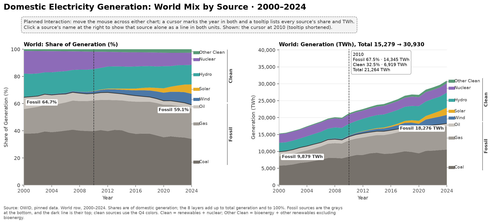
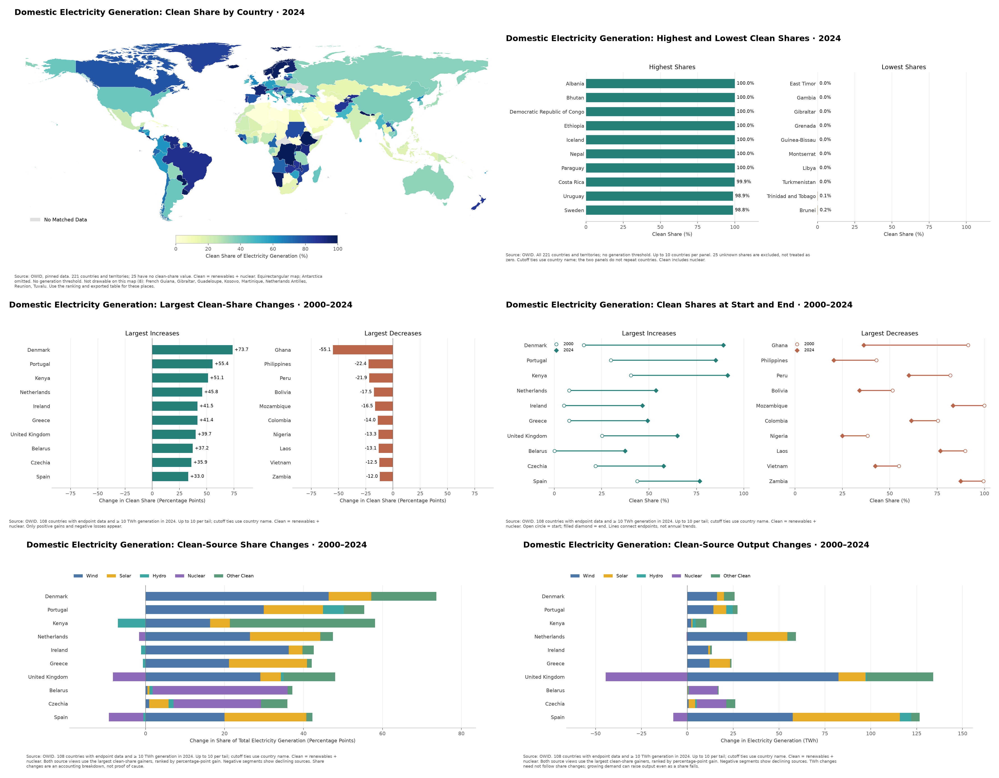
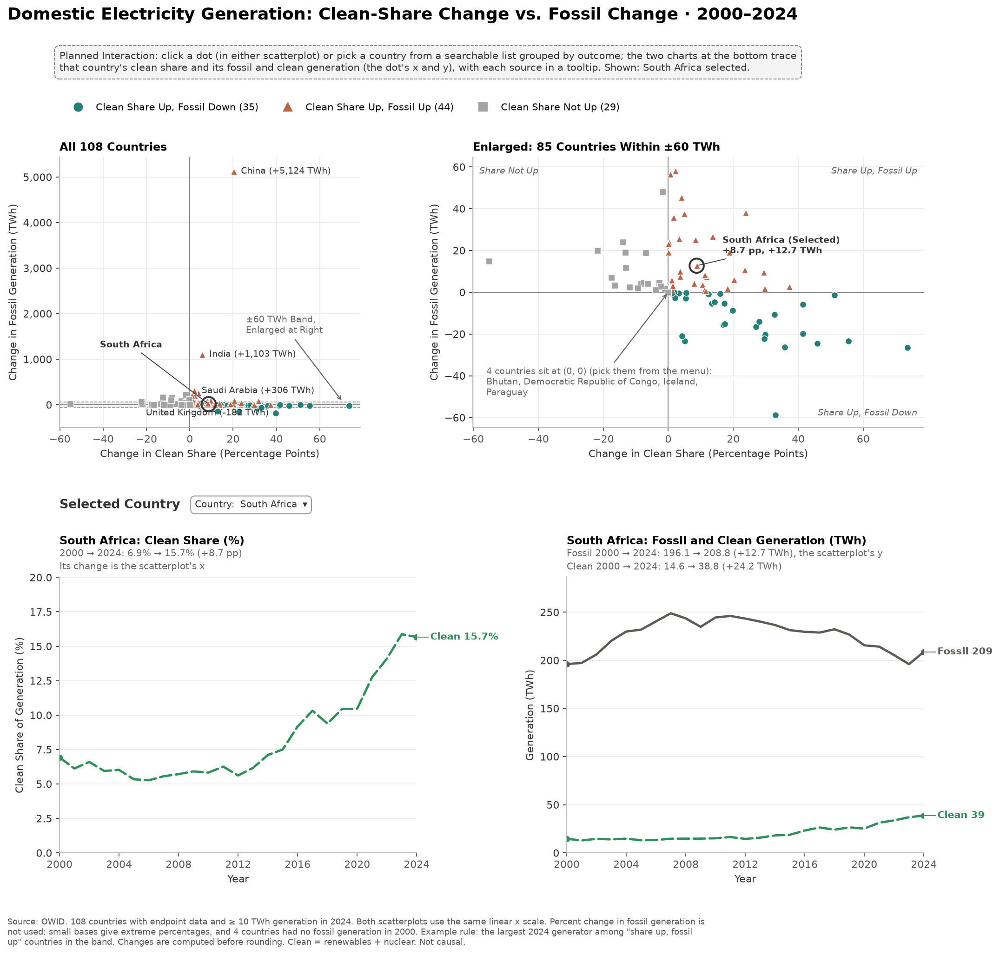
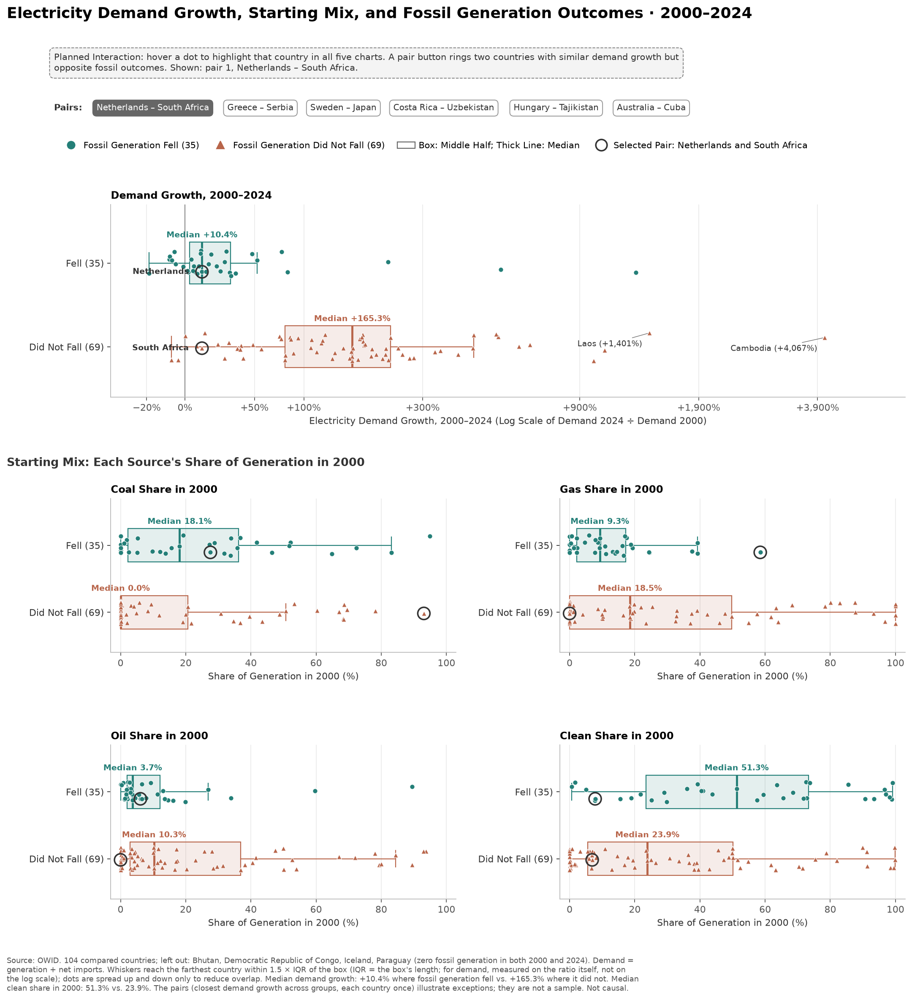

<!-- Source of reports/milestone2Report.pdf, the written M2 report for Brightspace. The text is copied from reports/dataHandlingQ2Q3Q4.md (Q2–Q4) and reports/dataHandlingQ1Q5Q6.md (Q1, Q5, Q6) in the structure of the Q2–Q4 report, so edits to those files do not reach this one. Image paths are relative to reports/. Other links are absolute GitHub URLs so they work in the PDF; update them when a linked file is renamed. The AI Use table is the same as the README's. -->

# Aurum: Cleaner Share, More Fossil Power?

**Milestone 2: Data Handling and Initial Sketches**  
CS-GY 6313 Information Visualization, NYU, Fall 2026 · November 2, 2026  
Team Aurum: Yathin Reddy Duvuru (yd3288), Yusuke Katsuki (yk3183)  
Repository: <https://github.com/Yahtze/InfoViz-Aurum>

## Scope and Current State

This report covers **all six questions**: Q2–Q4, which Yathin explored with six
Matplotlib sketches, and Q1, Q5, and Q6, which Yusuke explored with three. They are
exploratory views, not the final D3 application. The detailed reports in the repository are
[dataHandlingQ2Q3Q4.md](https://github.com/Yahtze/InfoViz-Aurum/blob/main/reports/dataHandlingQ2Q3Q4.md) (Q2–Q4) and
[dataHandlingQ1Q5Q6.md](https://github.com/Yahtze/InfoViz-Aurum/blob/main/reports/dataHandlingQ1Q5Q6.md) (Q1, Q5, Q6).

The baseline is 2024 for the snapshot and 2000–2024 for comparisons,
with a minimum of 10 TWh generation in 2024. The sketches show
up to 10 countries per tail. This report reads the preparation baseline tables,
not custom sketch settings. Custom sketch runs export their own CSVs and settings.

The tables below contain real processed rows, not synthetic examples. They are
**case samples**, not random or population-weighted samples. Each section states
the selection rule. Q4 contains all 10 plotted countries. The report displays two
decimal places; downloadable CSVs retain four decimals where applicable. Rounding
can make displayed sums differ by 0.01. **No Data** means unknown, not zero.
CSV samples use blank cells for the same unknown values. Q5 and Q6 show associations, not causes.

## Changes Since M1

> **We changed the comparison period and Q4. The problem, goal, hypothesis, dataset, and size threshold are the same as in the M1 proposal.**

| | M1 proposal (Oct 19) | M2 (now) |
| --- | --- | --- |
| Comparison period (Q3, Q5, Q6) | 2010–2024 | **2000–2024** |
| Q3 | "…between **2010** and 2024?" | "…between **2000** and 2024?" |
| Q4 | "…how much of the change came from **wind and solar compared with hydro and nuclear**?" | "…how much did **wind, solar, hydro, nuclear, and other clean sources each** contribute?" |
| Q6 | "…the initial electricity mix in **2010**…" | "…the initial electricity mix in **2000**…" |

Q1, Q2, and Q5 keep their M1 wording. [Cutoffs and Sensitivity](#cutoffs-and-sensitivity) explains the move to 2000 and checks the main result for other start years and size thresholds.

### Response to the M1 Feedback

| Feedback | What we did in M2 | Where |
| --- | --- | --- |
| Point 1: choose Q4's measure | Both measures for the same 10 countries. They can disagree: Kenya's hydro lost 7.02 pp of share but generated 1.79 TWh more. | Q4 |
| Point 2: define the terms | Clean (includes nuclear), fossil, share, pp, TWh, and demand. | Shared Data Handling |
| Point 3: justify the cutoffs | Reasons for 2000 and 10 TWh, and a sensitivity check. | Cutoffs and Sensitivity |
| Direction 1: compare similar demand growth | Group comparison, a hypothesis check, and six matched pairs. | Q6 |
| Direction 2: Δ clean share vs. Δ fossil TWh | A scatterplot with units on both axes and an enlarged ±60 TWh band. | Q5 |
| Missing data, shared scales, cues beyond color | Unknown values are shown as "No Data", not as zero. Compared views share scales. Q1, Q3, Q5, and Q6 do not rely on color alone. | Q1–Q6 |

The repository is shared with `ctsilva`. The README gives the dataset URLs and the AI-use table.

## Shared Data Handling

**Sources**
- Energy: pinned OWID energy file, data/raw/owid_energy_2026-09-30.csv (CC BY 4.0).
  Processing reads the local copy because the upstream download changes over time.
- Map: pinned world-atlas 2.0.2, data/raw/world-atlas-2.0.2-countries-50m.json
  (ISC; geometry from Natural Earth).

**Definitions**
- Clean electricity is nuclear, hydro, wind, solar, bioenergy, and other renewables
  excluding bioenergy. “Clean” is our short name for OWID's low-carbon category.
- Fossil electricity is coal + gas + oil. These are electricity measures, not total energy use.
- All six Q2–Q4 chart titles state **Domestic Electricity Generation**. These views do not
  measure all energy use or classify imported electricity by source.
- Shares use domestic electricity **generation**, not demand, as the denominator.
- Percentage points (pp) measure share differences: 20% to 30% is +10 pp, not +10% relative growth.

**Filters and Cleaning**
1. Retain 2000–2024, inclusive. The preparation code excludes 2025 as incomplete.
2. Keep country/territory rows with three-letter ISO codes. Assign XKX to Kosovo.
   Exclude regional aggregates and World from the Q2–Q4 selections.
3. Fill a blank source TWh with zero only when the known source TWh already sum to
   total generation within 0.01 TWh. Do not fill unknown totals or clean shares.
4. After that completeness check, fill a missing source share as
   100 × source TWh / generation TWh, only if generation is positive.
   Shares remain unknown for zero generation.
5. For endpoint comparisons, join by ISO3. Require known clean shares and fossil
   generation in both years and at least 10 TWh generation in 2024.
   The baseline has **108 eligible countries**. Q2 has no size threshold.
6. Map ISO3 to three-character ISO numeric IDs with pycountry. Preserve leading zeros
   such as Algeria's 012. The on_map flag tests atlas country-ID membership.
   The map reads only country geometry, preserves holes, and handles antimeridian crossings.
7. For sketches, break cutoff ties by country name and show at most 10 per tail.
   Q3 gain/loss tails exclude zero changes. The stored comparison rank is a descending
   row rank; its equal-value order does not specify the sketch's alphabetical tie policy.

**Additional Definitions**
- TWh (terawatt-hours) measures amounts of electricity: 1 TWh = 1 billion kWh.
- Demand is domestic generation plus net imports (OWID electricity_demand_twh).
  Generation and demand differ when a country trades electricity: 29 of the
  108 compared countries had net trade above 10% of their 2024 demand
  (15 net importers, 14 net exporters).

### Stored Tables

| File in data/processed/ | One Row Per | Size | Uses |
| --- | --- | --- | --- |
| country_year.csv | Country or World × observed year | 5,518 × 31 | Q1 (World row); Q2; Q3–Q6 endpoint/source inputs |
| comparison_2000_2024.csv | Eligible country | 108 × 46 | Q3–Q4; Q5–Q6 use the same 108 countries |
| robustness.csv | Start year × size threshold | 20 × 7 | Cutoffs and Sensitivity |

Country-years are observed records, not a fully imputed country × year grid.
The in_comparison_set flag repeats fixed country membership across years;
it is not a test of each individual year's eligibility.

## Q1 — The World's Electricity Mix

*Explored by Yusuke.*

**Question:** How has the global electricity mix changed from 2000 to 2024, in shares and in TWh?

**Transformation:** select the World row for 2000–2024. Group the sources into Coal, Gas, Oil,
Wind, Solar, Hydro, Nuclear, and Other Clean. The sketch checks that each year's values add up
to total generation and to 100% within 0.01.

**Result:** the clean share rose from 35.3% to 40.9%, but total generation grew from
15,279 TWh to 30,930 TWh. So fossil generation also grew, from 9,879 TWh to 18,276 TWh.
Q5 asks the same question for each country.

**Sample:** every fourth year from 2000 through 2024, in shares.
[q1_world_twh_sample.csv](https://github.com/Yahtze/InfoViz-Aurum/blob/main/reports/tablesQ1Q5Q6/q1_world_twh_sample.csv) has the same years in TWh.

| Year | Coal (%) | Gas (%) | Oil (%) | Wind (%) | Solar (%) | Hydro (%) | Nuclear (%) | Other Clean (%) | Total Generation (TWh) |
| --- | --- | --- | --- | --- | --- | --- | --- | --- | --- |
| 2000 | 38.02 | 17.97 | 8.67 | 0.20 | 0.01 | 17.21 | 16.63 | 1.29 | 15,278.78 |
| 2004 | 39.03 | 20.12 | 7.26 | 0.49 | 0.02 | 16.09 | 15.62 | 1.38 | 17,414.99 |
| 2008 | 40.16 | 21.69 | 5.83 | 1.10 | 0.06 | 16.14 | 13.40 | 1.61 | 20,102.64 |
| 2012 | 39.80 | 22.92 | 5.50 | 2.35 | 0.43 | 16.26 | 10.80 | 1.94 | 22,515.66 |
| 2016 | 37.77 | 23.69 | 4.39 | 3.89 | 1.33 | 16.26 | 10.41 | 2.26 | 24,694.51 |
| 2020 | 35.31 | 23.89 | 2.90 | 5.96 | 3.19 | 16.27 | 9.91 | 2.57 | 26,723.37 |
| 2024 | 34.07 | 22.25 | 2.76 | 8.11 | 6.93 | 14.33 | 8.98 | 2.56 | 30,930.23 |

[Download CSV](https://github.com/Yahtze/InfoViz-Aurum/blob/main/reports/tablesQ1Q5Q6/q1_world_share_sample.csv)

**Sketch:** two stacked area charts with the same eight layers, in shares (%) and in TWh.
Fossil layers are grays at the bottom, and a dark line marks their top. Clean layers use the
Q4 colors. Brackets label the Fossil and Clean groups, so the split does not rely on color alone.
The top of the TWh stack is total generation.
**Planned interaction:** a cursor marks the year in both charts, and a tooltip lists every
source. Clicking a source's name shows it alone as a line in both units, because middle layers
are hard to compare in a stack.

## Q2 — Country Clean Electricity Shares

*Explored by Yathin.*

The image above holds the six Q2–Q4 sketches: two views per question.

**Question:** How do countries compare in their clean shares in 2024?
Which have the highest and lowest shares?

**Transformation:** select year 2024 and country/territory rows, excluding World.
Keep countries of every generation size. Sort known clean shares for the ranked tails.
Join numeric IDs to atlas geometry, but retain unmapped places in the tabular data.

**Coverage:** 221 countries and territories, including
25 with unknown clean shares.
8 places have no drawable map geometry.
A false map flag does not imply a missing electricity value.

**Sample:** three countries at 100%, three at 0%, three large generators, and three cases of
map coverage or missing values.

Map IDs are text; keep leading zeros when importing the CSV.

| Country | ISO3 | Map ID | Total Generation 2024 (TWh) | Clean Share 2024 (%) | On Map |
| --- | --- | --- | --- | --- | --- |
| Albania | ALB | 008 | 8.34 | 100.00 | Yes |
| Bhutan | BTN | 064 | 11.00 | 100.00 | Yes |
| Democratic Republic of Congo | COD | 180 | 15.92 | 100.00 | Yes |
| East Timor | TLS | 626 | 0.51 | 0.00 | Yes |
| Gambia | GMB | 270 | 0.51 | 0.00 | Yes |
| Gibraltar | GIB | 292 | 0.22 | 0.00 | No |
| China | CHN | 156 | 10,086.88 | 38.17 | Yes |
| Germany | DEU | 276 | 495.99 | 58.64 | Yes |
| United States | USA | 840 | 4,391.02 | 41.87 | Yes |
| Kosovo | XKX | No Data | 6.77 | 8.57 | No |
| Ukraine | UKR | 804 | No Data | No Data | Yes |
| Lesotho | LSO | 426 | 0.00 | No Data | Yes |

[Download CSV](https://github.com/Yahtze/InfoViz-Aurum/blob/main/reports/tablesQ2Q3Q4/q2_country_shares_sample.csv)

**Sketch A — Geographic View:** a world choropleth with a common 0–100% color scale.
Gray means no matched data. The equirectangular map is not equal-area; Antarctica is omitted.
**Sketch B — Ranked View:** horizontal bars for the 10 highest and 10 lowest known shares.
Unknown values are excluded, not replaced with zero. Several leaders tie at 100%,
so the cutoff does not establish a unique best country.

## Q3 — Largest Changes in Clean Share

*Explored by Yathin.*

**Question:** Which countries had the largest increases or decreases from 2000 to 2024?

**Transformation:** use the 108 eligible endpoint pairs. Calculate
d_clean_share_pp = clean_share_pct_2024 − clean_share_pct_2000.
Select the top 10 strictly positive changes and the top 10 strictly negative
changes separately. This is a percentage-point difference, not percentage growth.

**Sample:** the three largest gains, the three largest losses, and China and India for reference.

Gain Rank refers to all 108 compared countries, not to a separate loss ranking.

| Country | Gain Rank | Clean Share 2000 (%) | Clean Share 2024 (%) | Clean Share Change (pp) |
| --- | --- | --- | --- | --- |
| Denmark | 1 | 15.54 | 89.19 | 73.65 |
| Portugal | 2 | 29.78 | 85.19 | 55.41 |
| Kenya | 3 | 40.37 | 91.48 | 51.11 |
| Ghana | 108 | 91.35 | 36.22 | -55.14 |
| Philippines | 107 | 42.89 | 20.47 | -22.42 |
| Peru | 106 | 81.98 | 60.11 | -21.87 |
| China | 24 | 17.87 | 38.17 | 20.29 |
| India | 48 | 16.81 | 22.49 | 5.69 |

[Download CSV](https://github.com/Yahtze/InfoViz-Aurum/blob/main/reports/tablesQ2Q3Q4/q3_share_changes_sample.csv)

**Sketch A — Change Magnitudes:** horizontal gain/loss bars with a shared zero-centered scale.
**Sketch B — Start and End Levels:** open circles mark 2000; filled diamonds mark 2024.
Both sketches use the same countries and order. Lines join endpoints, not annual trends.
This separates the size of a change from the starting and final electricity mix.

## Q4 — Clean Sources Behind the Largest Share Gains

*Explored by Yathin.*

**Question:** Among the largest clean-share gainers, how did wind, solar, hydro,
nuclear, and other clean sources each contribute to share and generation changes?

**Selection:** the top 10 positive clean-share gainers, ranked by pp, from the same
eligible comparison set. Both views use the same countries and order.
The TWh view does not reselect countries by absolute-output growth.

**Transformation:** subtract each source's start value from its end value. Keep Wind,
Solar, Hydro, and Nuclear separate. Sum bioenergy and other renewables excluding
bioenergy into Other Clean. Fossil sources are excluded.
These five components partition all six clean sources. Their sum equals the clean-share
change in pp or clean-generation change in TWh. Each share endpoint has its own
total-generation denominator.

### Sample A — Source Share Changes

| Country | Wind Change (pp) | Solar Change (pp) | Hydro Change (pp) | Nuclear Change (pp) | Other Clean Change (pp) | Net Clean Change (pp) |
| --- | --- | --- | --- | --- | --- | --- |
| Denmark | 46.39 | 10.78 | -0.03 | 0.00 | 16.51 | 73.65 |
| Portugal | 29.94 | 15.00 | 5.30 | 0.00 | 5.16 | 55.41 |
| Kenya | 16.36 | 4.98 | -7.02 | 0.00 | 36.78 | 51.11 |
| Netherlands | 26.43 | 17.83 | -0.09 | -1.54 | 3.20 | 45.82 |
| Ireland | 36.27 | 3.51 | -1.12 | 0.00 | 2.84 | 41.49 |
| Greece | 21.14 | 19.73 | -0.70 | 0.00 | 1.24 | 41.41 |
| United Kingdom | 29.06 | 5.20 | 0.68 | -8.27 | 13.08 | 39.74 |
| Belarus | 0.44 | 0.57 | 0.76 | 34.24 | 1.20 | 37.20 |
| Czechia | 0.92 | 4.93 | 1.24 | 22.15 | 6.68 | 35.91 |
| Spain | 20.00 | 20.74 | -0.54 | -8.75 | 1.53 | 32.97 |

[Download CSV](https://github.com/Yahtze/InfoViz-Aurum/blob/main/reports/tablesQ2Q3Q4/q4_source_changes_pp.csv)

### Sample B — Source Generation Changes

The same countries in TWh: [Download CSV](https://github.com/Yahtze/InfoViz-Aurum/blob/main/reports/tablesQ2Q3Q4/q4_source_changes_twh.csv).

**Sketch A:** diverging stacked changes in share, in pp.
**Sketch B:** diverging stacked generation changes, in TWh.
Right-hand segments show increases; left-hand segments show declines.
The plots show source contributions only, without net-change diamonds.
The sample tables retain the signed net clean change for reference.

For example, UK wind rises by 82.34 TWh and solar by
14.79 TWh; hydro rises by 0.67 TWh,
while nuclear declines by 44.47 TWh. Other Clean increases
by 36.21 TWh. These five source contributions sum to net
clean growth of 89.54 TWh; the separate values make the nuclear
decline visible rather than masking it within a broader category.

This is an accounting breakdown, not proof of cause. A source can gain TWh but lose share
when total generation grows faster. Missing source values cause the sketch calculation
to fail rather than being treated as zero.

## Q5 — Clean Share and Fossil Generation

*Explored by Yusuke.*

**Question:** Which countries raised their clean share while cutting fossil generation,
and which raised it but still generated more fossil electricity?

**Transformation:** use the 108 countries of Q3–Q4. Calculate
d_fossil_twh = fossil_twh_2024 − fossil_twh_2000. Sort each country into one of four
outcomes: clean share up with fossil down, up, or unchanged, or clean share not up.
Fossil change stays in TWh, because 4 countries had no fossil generation in 2000.

**Result:** of the 79 countries whose clean share rose, 35 cut fossil generation and
44 (55.7%) still generated more.

**Sample:** the 12 largest 2024 generators, plus South Africa. The sketch selects South Africa
as the largest 2024 generator among the "share up, fossil up" countries inside the ±60 TWh band.

| Country | Outcome | Clean Share Change (pp) | Fossil Generation 2000 (TWh) | Fossil Generation 2024 (TWh) | Fossil Generation Change (TWh) | Total Generation 2024 (TWh) |
| --- | --- | --- | --- | --- | --- | --- |
| China | Clean Share Up, Fossil Up | 20.29 | 1,113.30 | 6,237.20 | 5,123.90 | 10,086.88 |
| United States | Clean Share Up, Fossil Down | 12.81 | 2,697.28 | 2,552.53 | -144.75 | 4,391.02 |
| India | Clean Share Up, Fossil Up | 5.69 | 475.35 | 1,578.43 | 1,103.08 | 2,036.52 |
| Russia | Clean Share Up, Fossil Up | 2.34 | 582.89 | 774.74 | 191.85 | 1,209.31 |
| Japan | Clean Share Not Up | -6.92 | 679.52 | 698.37 | 18.85 | 1,016.39 |
| Brazil | Clean Share Not Up | -1.78 | 30.62 | 78.68 | 48.06 | 745.72 |
| Canada | Clean Share Up, Fossil Down | 5.11 | 165.57 | 142.04 | -23.53 | 636.79 |
| South Korea | Clean Share Up, Fossil Up | 0.96 | 177.37 | 375.91 | 198.54 | 625.38 |
| France | Clean Share Up, Fossil Down | 4.21 | 49.57 | 28.66 | -20.91 | 561.78 |
| Germany | Clean Share Up, Fossil Down | 22.61 | 363.93 | 205.13 | -158.80 | 495.99 |
| Saudi Arabia | Clean Share Up, Fossil Up | 2.16 | 138.69 | 444.82 | 306.13 | 454.64 |
| Iran | Clean Share Up, Fossil Up | 3.97 | 115.53 | 367.39 | 251.86 | 395.79 |
| South Africa | Clean Share Up, Fossil Up | 8.74 | 196.07 | 208.75 | 12.68 | 247.52 |

[Download CSV](https://github.com/Yahtze/InfoViz-Aurum/blob/main/reports/tablesQ1Q5Q6/q5_fossil_outcomes_sample.csv)

**Sketch:** two scatterplots of clean-share change (x, pp) and fossil change (y, TWh): all
countries, and an enlarged ±60 TWh band with the same x scale. The band holds 85 of the 108
countries, which overlap near zero next to China's +5,123.9 TWh. Color and marker shape both
show the outcome. Below them, two line charts trace the selected country over 2000–2024: its
clean share, and its fossil (solid gray) and clean (dashed green) generation.
**Planned interaction:** clicking a dot or choosing a country from a menu redraws the lines,
and a tooltip lists each source by year.

## Q6 — Demand Growth and the Starting Mix

*Explored by Yusuke.*

**Question:** How do demand growth and the 2000 mix differ between countries that reduced
fossil generation and those that did not?

**Transformation:** start from the Q5 table. Leave out the 4 countries with no fossil
generation in either year, which leaves 104. Calculate
demand_growth_pct = 100 × (demand_2024 / demand_2000 − 1). Group countries by
fossil_reduced (d_fossil_twh < 0).

**Sample A — Groups:** demand growth by group.

| Group | Countries | Median Demand Growth (%) | Lower Quartile (%) | Upper Quartile (%) |
| --- | --- | --- | --- | --- |
| Fossil Generation Fell | 35 | 10.41 | 2.80 | 30.35 |
| Did Not Fall | 69 | 165.27 | 79.25 | 231.50 |

[Download CSV](https://github.com/Yahtze/InfoViz-Aurum/blob/main/reports/tablesQ1Q5Q6/q6_group_summary.csv)

**Starting mix:** where fossil generation fell, the median 2000 clean share was higher:
51.3% against 23.9%. The middle halves overlap, so the starting share alone does not separate
the groups. [q6_start_mix.csv](https://github.com/Yahtze/InfoViz-Aurum/blob/main/reports/tablesQ1Q5Q6/q6_start_mix.csv)
gives the medians of the four 2000 shares; separate medians need not add up to 100%.

**Hypothesis check:** the proposal expected fossil cuts to be less common where demand grew
fast; more frequent cuts there would contradict it. Among the 79 countries whose clean share
rose, split at their median demand growth (75.4%), fossil generation fell in 30 of the 40 at
or below it and in 5 of the 39 above it. This is consistent with the hypothesis but does not
show a cause. The fast-growing exceptions are Costa Rica, Ethiopia, Kenya, Nepal, and Uruguay.

**Sample B — Matched Pairs:** for each country whose fossil generation fell, find the country
with the closest demand growth whose fossil generation did not fall. Take the smallest gaps
first, use each country once, and break ties by name. The 6 pairs illustrate exceptions,
not a sample.

| Pair | Fossil Fell | Demand Growth, Fell (%) | Fossil Did Not Fall | Demand Growth, Did Not Fall (%) | Gap (pp) |
| --- | --- | --- | --- | --- | --- |
| 1 | Netherlands | 10.41 | South Africa | 10.42 | 0.00 |
| 2 | Greece | 7.25 | Serbia | 7.21 | 0.05 |
| 3 | Sweden | -7.47 | Japan | -7.57 | 0.10 |
| 4 | Costa Rica | 75.59 | Uzbekistan | 75.38 | 0.20 |
| 5 | Hungary | 26.15 | Tajikistan | 25.88 | 0.26 |
| 6 | Australia | 29.89 | Cuba | 29.27 | 0.61 |

[Download CSV](https://github.com/Yahtze/InfoViz-Aurum/blob/main/reports/tablesQ1Q5Q6/q6_matched_pairs.csv)

**Sketch:** five charts, each with one box per group (quartiles and median) and every country
as a dot: demand growth, then the 2000 share of coal, gas, oil, and clean generation on a
common 0–100% scale. Demand growth uses a log scale of demand_2024 / demand_2000 (1× = no
change), labeled as percent change, because Cambodia's +4,066.7% would crowd the rest.
A country's dot keeps the same height within its group in every chart.
**Planned interaction:** hovering a dot highlights that country in all five charts; a pair
button rings both countries of the pair.

## Cutoffs and Sensitivity

*Yusuke's analysis.*

**Start year 2000:** the proposal started in 2010. The comparisons now start in 2000, like Q1.
At 10 TWh, both start years compare 108 countries. An earlier start would compare fewer: the
raw OWID file has generation data for 81 places in 1999 and 211 in 2000.

**Size threshold 10 TWh in 2024:** in a small system, one new plant can move the clean share
by many points. The threshold keeps 108 of the 193 countries with data in both years.

**Sensitivity:** data/processed/robustness.csv recalculates the Q5 result for four start
years and five thresholds: the percentage of countries with a rising clean share that also
generated more fossil electricity.

| Start Year | ≥ 0 TWh (%) | ≥ 5 TWh (%) | ≥ 10 TWh (%) | ≥ 20 TWh (%) | ≥ 50 TWh (%) |
| --- | --- | --- | --- | --- | --- |
| 2000 | 59.90 | 56.40 | 55.70 | 56.90 | 53.70 |
| 2005 | 52.50 | 48.90 | 49.40 | 50.00 | 50.00 |
| 2010 | 51.40 | 47.50 | 49.40 | 47.10 | 52.20 |
| 2015 | 46.70 | 45.70 | 46.70 | 45.80 | 47.90 |

**Result:** every setting has at least 20 countries whose clean share and fossil generation
both rose, so the gap between share and amount appears with every cutoff. Whether they are a
majority depends on the cutoffs. The proposal's 2010 start at 10 TWh gives 49.4% (41 of 83).
The grid checks only the Q5 result, not Q6.

## Created and Derived Features

[Feature dictionary](https://github.com/Yahtze/InfoViz-Aurum/blob/main/reports/tablesQ2Q3Q4/feature_dictionary.csv): **46 stored columns**
used for Q2–Q4, with units, input fields, and transformation rules.
It covers the relevant fields in the two processed tables, not unrelated fields.
Copied/renamed source measures are distinguished from newly derived features.

[Feature dictionary](https://github.com/Yahtze/InfoViz-Aurum/blob/main/reports/tablesQ1Q5Q6/feature_dictionary.csv): **14 columns** that
Q1, Q5, and Q6 use beyond the [Q2–Q4 feature dictionary](https://github.com/Yahtze/InfoViz-Aurum/blob/main/reports/tablesQ2Q3Q4/feature_dictionary.csv), with
units, input fields, and transformation rules. Generation, the clean share, and the clean
sources are documented there.

Sketch exports use _start and _end suffixes rather than year suffixes. Their source tables
use configurable group labels as columns and total for net clean change.
Custom sketch groups must include every clean source exactly once.

## Reproduction and Checks

Run from the repository root:

    uv sync --locked
    uv run python prep/report_q234.py
    uv run python -m sketches --preview outputs/sketchesQ2-4.png
    uv run python -m prep.report_q156
    uv run python -m unittest discover -s tests -v

- prep/report_q234.py checks source totals, clean shares, endpoint consistency, map coverage,
  finite values, and the main country counts.
- sketches/sketchesQ2Q3Q4/data.py recalculates selections and source changes for configured dates.
  Source groups must sum to net change within 0.01 in the relevant unit.
- The overview montage is tracked at outputs/sketchesQ2-4.png.
- sketches/q156_data.py checks that the eight Q1 groups add up to generation and to 100%,
  and recalculates the Q5 outcomes and the Q6 groups and pairs for configured dates.
- prep/report_q156.py checks that the documented fields exist. tests/test_q156.py checks that the Q1, Q5, and Q6 report's tables
  match what the default sketches compute.
- The figures are tracked at outputs/sketchesQ1.png, sketchesQ5.png, and sketchesQ6.png.
- Processed values already use four decimals. The report only rounds for display.
  It does not edit raw data or impute missing values.

## AI Use

| Date | Tool | What it produced | How we checked it |
|---|---|---|---|
| 2026-10-18 to 11-02 | Claude and Claude Code (Anthropic), Codex (OpenAI) | The M1 proposal draft; the repository setup and `prep/report_q234.py`; Q1, Q5, and Q6 drafts, report outlines, and tests, based on Yusuke's design ideas; the combined M2 report outline. Codex reviewed them | Yusuke reviewed the text and figures; tests check sums, counts, and that the report matches the sketches |
| 2026-10-31 | Codex (OpenAI) | Python code and Matplotlib syntax for Q2–Q4, based on plot types and visualization descriptions specified by Yathin | Automated tests check data selection, source totals, and plot structure |
